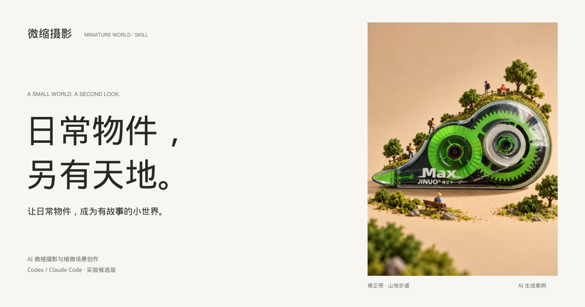
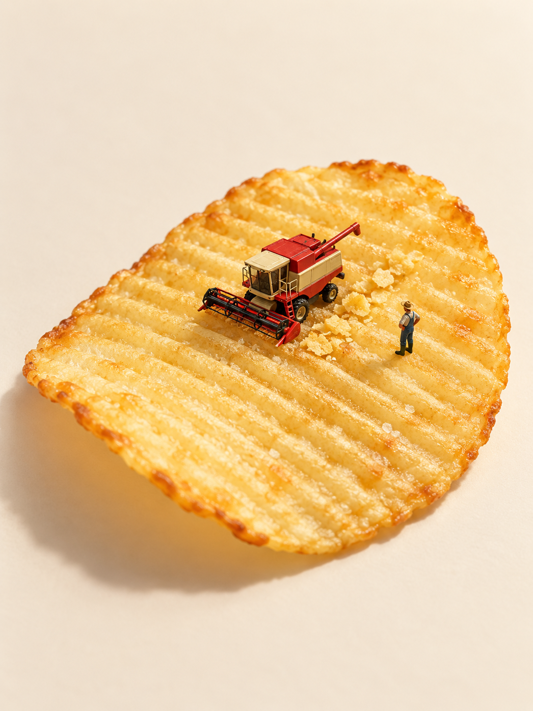

# Miniature World · Miniature Photography Skill



**Turn everyday objects into small worlds with a story.**

An Agent Skill for Codex and Claude Code that finds visual connections in an object's shape, texture and structure, plans a miniature scene, and uses available image tools to generate and revise it. Inspired by Tatsuya Tanaka (田中达也) and his mitate approach to miniature photography: seeing everyday objects as something else.

[View website](https://denggui-ai.github.io/create-miniature-world/site/) · [中文](README.md) · [Installation](#getting-started) · [case gallery](https://denggui-ai.github.io/create-miniature-world/site/gallery.html) · [Case notes and sources](examples/SELECTED.md)

> **v0.1.0 is released.** [Release and installation archive](https://github.com/denggui-ai/create-miniature-world/releases/tag/v0.1.0). Two real-photo grater samples passed user review for visible product fidelity, story, figure scale and aesthetics on 2026-10-13. Codex reference generation, requested editing and saving have actual evidence. On 2026-10-14, both project installs matched all 11 runtime files in source and the release package, and a fresh Codex session explicitly loaded the installed skill. Claude Code retains its install/planning validation; its fresh session and new routes were not retested. Exact SKU details, text, microscopic patterns and cross-product consistency are not guaranteed. Fresh-host install and full upgrade/uninstall remain unverified. See the [sample comparison](examples/GRATER_VALIDATION_20261013.md) and [offline guide](docs/USER-GUIDE.html).

## See the idea

| Notebook → bicycle rack | Potato chip → harvest field |
| --- | --- |
|  |  |

The homepage features three cases: comb, notebook and potato chip. The comb cover is an AI layout adaptation; the [original comb image](examples/comb-farm.png) is retained separately. The two images above are original AI-generated development examples. Each product has one representative image; limitations and evidence are recorded in the [case collection](examples/SELECTED.md) (Chinese). They are not proof of local-host compatibility or exact product fidelity.

## Getting started

Clone this public repository, or download its ZIP from the Code menu; no repository access invitation is required. Open the project in your local host.

```bash
git clone https://github.com/denggui-ai/create-miniature-world.git
cd create-miniature-world
```

The only installable source directory is `skills/create-miniature-world/`. Check for an existing installation before copying; compare rather than overwrite it.

| Host | Suggested project-local destination | Invoke after confirming discovery |
| --- | --- | --- |
| Codex | `.agents/skills/create-miniature-world/` | `$create-miniature-world` |
| Claude Code | `.claude/skills/create-miniature-world/` | `/create-miniature-world` |

Use one installation scope and verify the actual loaded files in a fresh task. The current Codex display label is `微缩造景`. Installation and update details are in [docs/INSTALL.md](docs/INSTALL.md) (Chinese).

Attach a product photo and ask. Your host and its image tool process the photo and prompt; upload only material you may share with those services. This project website does not receive photos or generate images.

> Turn this product into a miniature photograph. First propose three distinct concepts connected to its visible features. Do not generate an image yet.

Choose a concept, request one image, then give a specific revision such as “Make the figures smaller while keeping the product and composition.” Reading an image does not imply the generation tool can receive it. Without image tools, the skill can provide concepts and prompts only.

## The method

- **Find a connection:** notice a feature worth seeing differently.
- **Build a situation:** make that connection visible through action or spatial relationships.
- **Compose the image:** keep the original object, its new role and the overall image readable.
- **Review the result:** assess story, appearance and product fidelity separately, using visible evidence and comparisons when needed.

A story can be a small everyday moment. It does not need conflict, and it does not have to demonstrate the product's normal function. The product itself must contribute to the idea.

## Two photo styles: Tanaka-inspired / Photo-real light

| | Tanaka-inspired (default) | Photo-real light |
| --- | --- | --- |
| When | You do not mention a style | You ask for a real-photo feel, light and shadow, natural light |
| Light | One soft warm key from the upper left, short soft shadows | One window light or low warm sunbeam, no fill; highlights may clip, hollows go dark |
| Backdrop and camera | Off-white matte paper; near the figures' eye level or slightly above | Feels like a 100mm macro shot, camera a little above the object |
| Focus | The product reads clearly | Only the figures and their contact point are sharp; the rest falls off gradually |
| Figures | About 9% of the image height | Also written as about 9%; macro may draw them a little larger (ceiling 15%) |

"Tanaka-inspired" names a bright tabletop look inspired by Tatsuya Tanaka's work; it is not his workflow and implies no endorsement. Ideas, figure appearance and product-fidelity rules are the same in both styles. When Python 3, Pillow and NumPy are available, the skill also saves a lightly finished copy (fine grain, optional gentle focus falloff) and delivers it with the original.

## Requirements and limits

Requires an image-reading host; generation, image references and editing each depend on tools actually available in that session. No model, credits, API keys or paid-service client are bundled. The default output is one opaque portrait image in a 3:4 ratio.

Product lettering, construction and figure scale can still be wrong. Exact SKU preservation and exact figurine matching are not guaranteed. Figures are sized in the frame (about 9% of the image height, tiny next to a giant object) rather than from product millimetres; this is not a universal scale used by the artist or Preiser. Three author-shot 1:87 figure photos ship as paint references ([notes and license](skills/create-miniature-world/assets/figure-refs/README.md), CC BY-NC 4.0). See [validation](docs/VALIDATION.md) and the [local test](docs/LOCAL_TEST.md) (Chinese).

## Inspiration and materials

With appreciation for [Tatsuya Tanaka / MINIATURE CALENDAR](https://miniature-calendar.com/about/) and the possibilities of mitate. This project's method is its own synthesis of visual study and experiments, not the artist's published workflow. [Preiser](https://www.preiserfiguren.de/) is a useful official reference for miniature figures and poses.

This is an independent project, with no official affiliation or endorsement from the artist or Preiser. Original project text and configuration use the [MIT license](LICENSE). Images and third-party materials are not automatically covered by MIT; see [THIRD_PARTY_NOTICES.md](THIRD_PARTY_NOTICES.md).

## Feedback and development

Report the host, loaded version, input, expected result and observed problem. Include an image only when you have permission to share it. Distinguish missing tools from unreadable stories, altered products and oversized figures; do not include secrets.

Codex developers start with [AGENTS.md](AGENTS.md); Claude Code developers start with [CLAUDE.md](CLAUDE.md). Both use the same [handoff](docs/DEVELOPMENT_HANDOFF.md). Keep one source in `skills/create-miniature-world/`; update installed copies deliberately. The repository and invocation identifier remain `create-miniature-world`.
