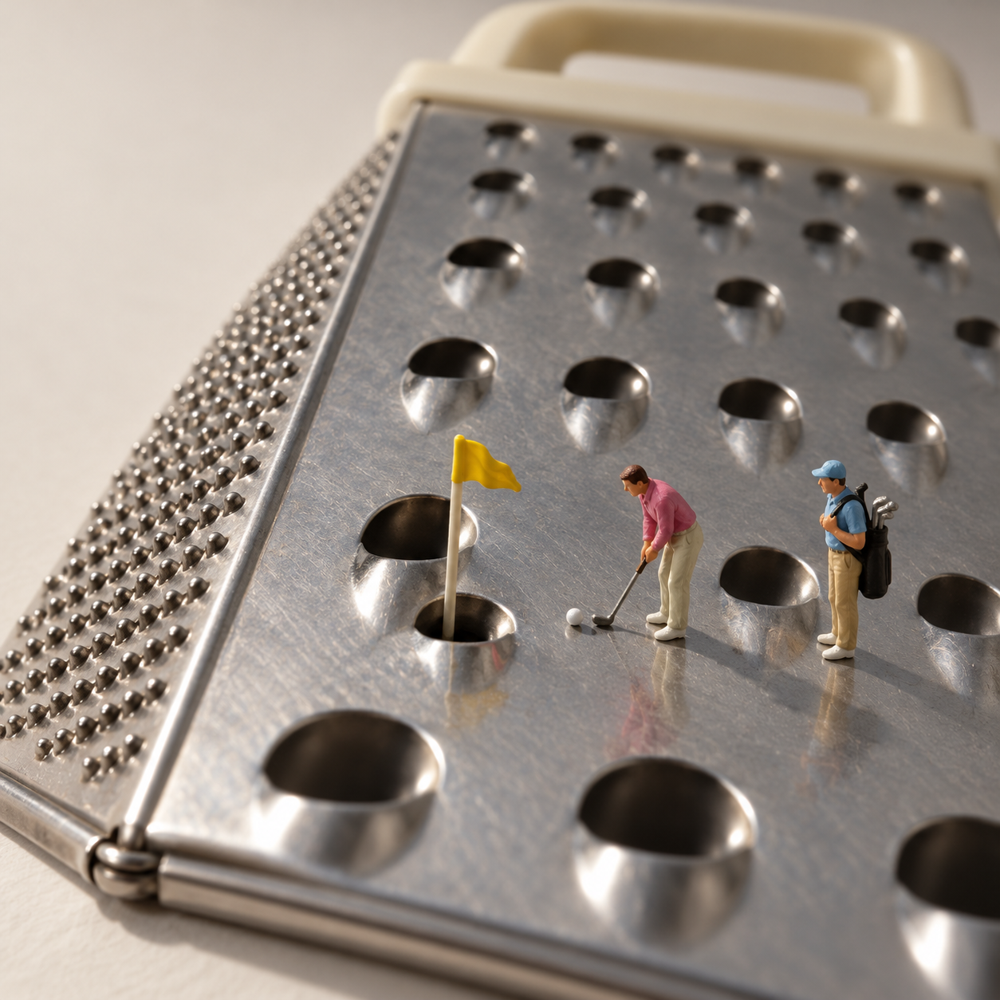
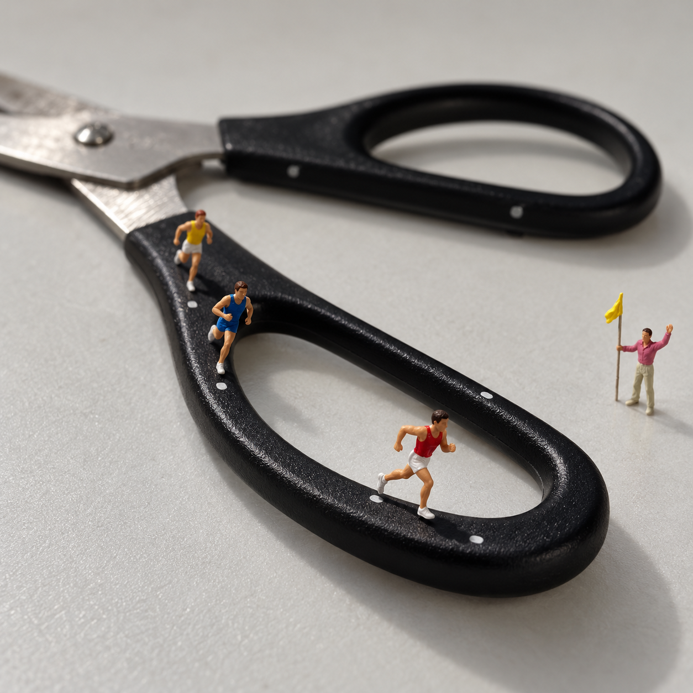

# Miniature World · Miniature Photography Skill

**Paper clips become hurdles. A grater becomes a putting green. Everyday objects hold small worlds.**

Give Codex or Claude Code an object name or a product photo to plan miniature photography with a story. It uses the object's shape, texture and structure to work out the tiny figures' actions, scale, camera angle and lighting, then creates the image with your environment's image tools.

Review ideas first, request an image directly, or get prompts only. Use it for everyday-object concepts, miniature product scenes and mitate photography practice.

[Website](https://denggui-ai.github.io/create-miniature-world/site/en/) · [Gallery](https://denggui-ai.github.io/create-miniature-world/site/gallery.html) (Chinese captions) · [English guide](docs/GETTING_STARTED.en.md) · [Download latest](https://github.com/denggui-ai/create-miniature-world/releases/latest) · [中文](README.md) · [日本語](README.ja.md)

| Paper clips → hurdles | Grater → putting green | Scissors → relay track |
| --- | --- | --- |
|  |  |  |
| A hurdles final; the leader is already in the air. | A golfer putts while the caddie looks on. | A relay race around the handle loop. |

AI-generated, one generation each. How they were made is in the [case notes](examples/PICTURE_CARD_CASES_20261021.md) (Chinese). More in the [gallery](https://denggui-ai.github.io/create-miniature-world/site/gallery.html).

## Start with one object

| What you provide | What you can create |
| --- | --- |
| An object name, such as “mug” | Scenes inspired by its outline, texture or structure; review ideas first or generate directly |
| A product photo | A story linking tiny figures to the object, with its visible appearance as a preservation goal; use photo editing when the image is a suitable base |
| A specific idea | Follow your story without adding extra candidate concepts |
| A text-only request | Concepts or complete image prompts, without calling image tools |

**The object itself becomes the scene.** What the figures do, and why they are there, should relate to its visible structure. Inspired by Tatsuya Tanaka's mitate approach; see [Inspiration and materials](#inspiration-and-materials).

## Installation and your first creation

**1. Install** (first install only, when the target folder does not exist yet; if a copy is already installed, back it up and compare first, see [installation](docs/INSTALL.md))

Get the repository first:

```bash
git clone https://github.com/denggui-ai/create-miniature-world.git
```

In your target project, choose one project-level location for your host:

| Host | Installation location |
| --- | --- |
| Codex | `.agents/skills/create-miniature-world/` |
| Claude Code | `.claude/skills/create-miniature-world/` |

Copy the repository's `skills/create-miniature-world/` folder in full to that location. **Install this Skill folder only, not the entire repository.** See [installation](docs/INSTALL.md) (Chinese) for first-install scripts, updates and backups, or the [English guide](docs/GETTING_STARTED.en.md). Compare any existing copy before replacing it.

**2. Open a fresh session and send a product photo with one line** (an object name alone also works)

| Host | Send |
| --- | --- |
| Claude Code | `/create-miniature-world Use this product photo. Show me the ideas first. Do not generate images yet.` |
| Codex | `Use $create-miniature-world with this product photo. Show me the ideas first. Do not generate images yet.` |

**3. Pick an idea**, say "Generate one image for idea 1, keeping the product's appearance", then ask for one focused change after you see the image.

**Image creation depends on your host's capabilities.** Codex can generate or edit when image tools are available. When Claude Code has no built-in generation, you get concepts and prompts for your existing image tools. No model, API key or image credits are bundled.

## How to talk to it

| You say | It does |
| --- | --- |
| You choose the idea, make one | Reads the object, compares candidates, picks one and generates when a tool is available |
| Show me the ideas first | Each idea in words: where the camera is, who is doing what, which part of the object becomes what |
| Just give me the prompt | Text only, no generation |
| Edit my real photo | If the photo is taken close to the table with the object large and a clean background, it keeps the photo and only adds figures and props |
| Make the people smaller | Rescales figures and their props, protecting the product |
| I don't get the story | Rechecks the object link, the action and the spatial relationships; changes the situation if needed |

With a product photo or a specified product, preserving its visible appearance is the default goal; a generic object name allows free creation. Square frame by default; any ratio you specify takes priority. Direct creation defaults to two ideas with one image each; a specific idea, a request for one image, or only one viable concept results in one image. One first image per idea; at most one edit, only on the image you name; no retries or automatic extra images.

## How it comes up with ideas

It pictures the shot before making it: where the camera is, what looks huge, how small the people are ("as tall as one hole"), which part of the object becomes what, and what is happening. When ideas run short, it looks through 20 text-only case cards of Tanaka's works and borrows the idea, not the picture.

There are two ways to make the image: with only an object name, the whole picture is generated; with a photo taken close to the table and the object large in frame, it keeps your photo and only adds figures and props. Afterwards it asks you one thing, "what is this scene?" If you read the story at a glance, it worked.

## More examples and tutorials

- [English first-use guide](docs/GETTING_STARTED.en.md#follow-the-examples), which introduces the case tutorials
- [Orange photo → planet survey](https://denggui-ai.github.io/create-miniature-world/site/orange.html): two concepts, then one edit to shrink the figures (Chinese)
- [Remote control photo → two results](https://denggui-ai.github.io/create-miniature-world/site/remote-control.html): one real photo, two tiny worlds (Chinese)
- [All cases and reviews](examples/README.md) (Chinese)

## Requirements and limits

- **Works best** with objects whose outline, texture, structure or opening suggests something else; a product photo helps. Success is not guaranteed by category, and the product's structure is not changed for the story.
- **Product fidelity**: lettering, parts and proportions can still come out wrong, especially with direct generation. An appealing idea is not an exact SKU match.
- **Figures**: scale follows the relationship between a person and a part of the object, not millimetres. Three bundled figure photos are style references only ([notes and license](skills/create-miniature-world/assets/figure-refs/README.md), CC BY-NC 4.0).
- **Local finishing** runs only on request and needs Python 3, Pillow and NumPy; otherwise the original is delivered.
- **What has been verified** for each version is in the [release notes](https://github.com/denggui-ai/create-miniature-world/releases) and the [validation log](docs/VALIDATION.md) (Chinese). Other machines, other platforms and implicit desktop triggering are unverified; no stable success rate is claimed.

## Inspiration and materials

With appreciation for [Tatsuya Tanaka / MINIATURE CALENDAR](https://miniature-calendar.com/about/) and the possibilities of mitate. This project's method is its own synthesis of visual study and experiments, not the artist's published workflow; the case cards contain text and links to the artist's own article pages only, with no copied images. [Preiser](https://www.preiserfiguren.de/) is a useful official reference for figures and poses.

This is an independent project, with no official affiliation or endorsement from the artist, MINIATURE CALENDAR, Preiser or the product brands shown in examples. Code and original text use the [MIT license](LICENSE); images and third-party materials are not automatically covered, see [THIRD_PARTY_NOTICES.md](THIRD_PARTY_NOTICES.md).

## Versions, feedback and maintenance

The current version, archive, SHA-256 and release notes are on [Releases](https://github.com/denggui-ai/create-miniature-world/releases/latest). Report problems with the [issue template](https://github.com/denggui-ai/create-miniature-world/issues/new?template=bug_report.md): host, loaded version, input, expected and actual result; share only images you may share and never credentials. Maintainers see [MAINTAINING.md](docs/MAINTAINING.md); the only source is `skills/create-miniature-world/`, and installed folders are copies.
