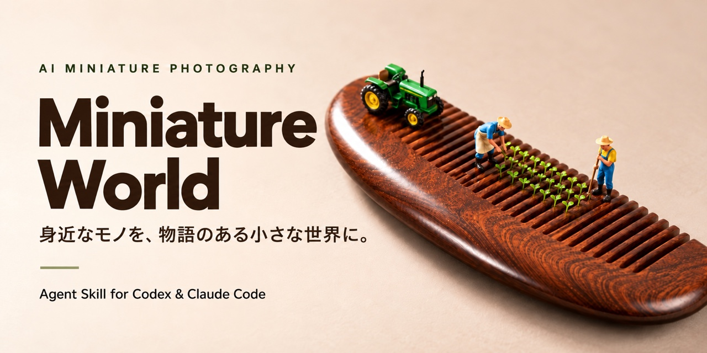
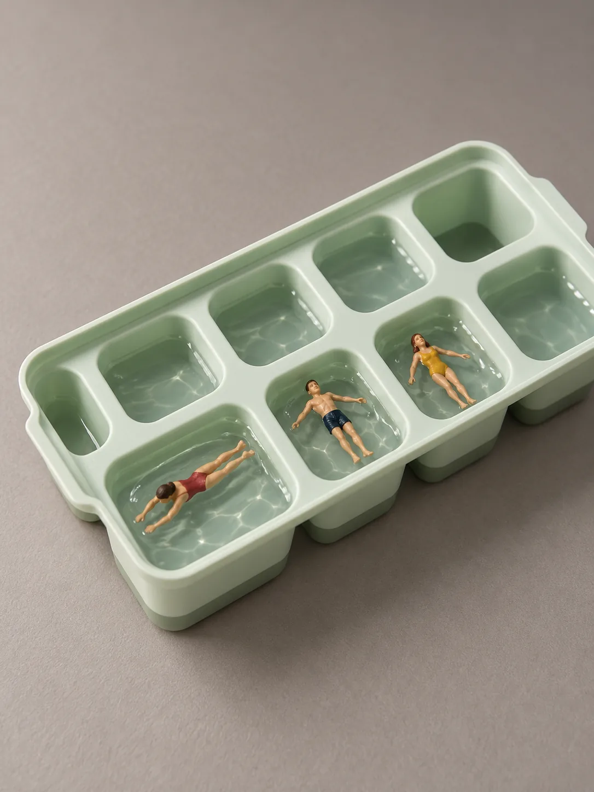

<p align="center"><a href="README.md">English</a> · <a href="README.zh-CN.md">简体中文</a> · <a href="README.ja.md">日本語</a></p>

<h1 align="center">Miniature World · Agent Skill</h1>

<p align="center"><strong>身近なモノを、物語のある小さな世界に。</strong><br>Codex と Claude Code のためのミニチュア写真 Skill。</p>

<p align="center"><a href="https://denggui-ai.github.io/create-miniature-world/site/ja/"></a></p>

<p align="center"><a href="https://denggui-ai.github.io/create-miniature-world/site/ja/">紹介サイト</a> · <a href="#インストールと最初の制作">使いはじめる</a> · <a href="https://denggui-ai.github.io/create-miniature-world/site/gallery.html">ギャラリー（説明は中国語）</a> · <a href="https://github.com/denggui-ai/create-miniature-world/releases/latest">ダウンロード</a></p>

<p align="center">
  
  
</p>

<p align="center">ノートと鉛筆 · ページをつなぐ橋 · 製氷皿 · ひとり一つのプール</p>

AI 制作の作例：[鉛筆の橋の制作過程](docs/SECONDARY_CREATION.md) · [製氷皿の構想と振り返り](examples/PLANNING_PHOTOGRAPHY_CASES_20261019.md)（中国語）。

## ひとつのモノからはじめる

| 用意するもの | できること |
| --- | --- |
| 「マグカップ」などのモノの名前 | 輪郭・質感・構造からシーンを考え、案を見せるか直接生成する |
| 商品写真1枚 | 見える外観を守ることを目標に、小人とモノの物語を構想する。下地に適した写真なら編集ルートを使う |
| 具体的なアイデア | 指定された物語に沿って制作し、余分な候補を追加しない |
| 文章だけの依頼 | 案や画像生成プロンプトを渡し、画像ツールは呼び出さない |

**モノそのものが舞台になります。** 小人が何をしているのか、なぜそこにいるのかを、モノの見える構造につなげます。田中達也さんの「見立て」に着想を得ています。詳しくは[着想と敬意](#着想と敬意)をご覧ください。

## インストールと最初の制作

**1. インストール**（初めて入れる場合。同名の Skill がすでにある場合は、先に[インストール説明](docs/INSTALL.md)（中国語）に沿ってバックアップと比較をしてください）

まずリポジトリを取得します。

```bash
git clone https://github.com/denggui-ai/create-miniature-world.git
```

使いたいプロジェクトで、ホストに合うインストール先をひとつ選びます。

| ホスト | プロジェクト内のインストール先 |
| --- | --- |
| Codex | `.agents/skills/create-miniature-world/` |
| Claude Code | `.claude/skills/create-miniature-world/` |

リポジトリの `skills/create-miniature-world/` を、選んだ場所にフォルダごとコピーします。**この Skill フォルダだけを入れ、リポジトリ全体はコピーしないでください。** 初回インストール用スクリプト、更新、バックアップは[インストール説明](docs/INSTALL.md)（中国語）にあります。同名のコピーがある場合は、上書きせず先に比較してください。

**2. 新しいセッションで、商品写真と一言の指示を送る**（写真がなければモノの名前だけでも可）

| 環境 | 送る文 |
| --- | --- |
| Claude Code | `/create-miniature-world この商品写真でミニチュア写真を作って。まず案を見せて、まだ生成しないで。` |
| Codex | `$create-miniature-world を使って、この商品写真でミニチュア写真を作って。まず案を見せて、まだ生成しないで。` |

**3. 案を選ぶ。**「案1で1枚生成、商品の見た目はそのままで」と伝え、画像を見てから直したい点を1つだけ伝えます。

**画像の生成・編集はホストの機能に依存します。** Codex は画像ツールを利用できる場合に生成・編集できます。Claude Code に内蔵生成がない場合は、案とプロンプトを受け取り、お手持ちの画像ツールで生成できます。モデル、API キー、生成クレジットは同梱していません。

## こんなふうに頼めます

| あなたの依頼 | Skill の動作 |
| --- | --- |
| アイデアは任せるので1枚作って | モノを読み取り、候補を比べて選び、ツールが使えれば生成する |
| まず案を見せて、まだ生成しないで | カメラ位置、誰が何をするか、モノのどの部分が何になるかを文章で示す |
| プロンプトだけほしい | 文章だけを渡し、画像は生成しない |
| この実物写真を直接編集して | 低い位置から近くで撮り、モノが大きく、背景が整った写真なら、小人と小道具を加える |
| 人物をもっと小さくして | 商品を守りながら、人物と関連する小道具の比率を調整する |
| 何の場面か分からない | モノとのつながり、動作、位置関係を見直し、必要なら場面を変える |

商品写真や特定の商品を指定した場合は、見える外観を守ることを基本にします。一般的なモノの名前だけなら自由に創作します。画面は正方形が基本で、指定の比率を優先します。直接制作は原則2案を各1枚。具体的なアイデア、1枚だけの依頼、成立する案がひとつの場合は1枚です。各案の初回生成は1枚で、編集は指定された画像だけに最大1回。失敗時の再試行や自動追加はしません。

## アイデアの考え方

制作の前に、カメラ位置、何が巨大に見えるか、小人はどの部品と同じくらいの高さか、モノのどの部分が何になるか、そこで何が起きているかを考えます。連想が足りないときは、田中達也さんの作品を文章でまとめた20件のケースカードを参照し、仕組みを学びます。画面そのものは写しません。

モノの名前だけなら画面全体を生成します。下地に適した実物写真があれば、その写真に小人と小道具を加える方法を選びます。完成後の問いは「これは何の場面ですか」。ひと目で読み取れる物語かどうかが判断の手がかりです。

## 作例とチュートリアル

以下の作例解説は中国語です。

- [マグカップのコーヒー跡 → ランニングコース](https://denggui-ai.github.io/create-miniature-world/site/coffee-ring.html)：モノの名前から物語へ
- [オレンジの実物写真 → 惑星探査](https://denggui-ai.github.io/create-miniature-world/site/orange.html)：2案を比べ、1回の編集で人物を小さくする
- [リモコン写真 → 2つの小さな世界](https://denggui-ai.github.io/create-miniature-world/site/remote-control.html)：実物写真からの制作
- [すべての作例と振り返り](examples/README.md)

## できること・できないこと

- **向いているもの**：輪郭・質感・構造・開閉のしかたから別のものが連想できるモノ。商品写真を優先しますが、品目だけで成功を保証したり、物語のために商品の構造を勝手に変えたりはしません。
- **作り方は2通り**：モノの名前だけ、または写真が下地に使えない場合は直接生成（商品は描き直され、部品や穴の形が変わることがあります）。カメラが近くて低く、モノが画面に大きく写り、台がきれいで、光が柔らかい写真なら、その写真に人形と小物だけを足す編集ルートを使い、商品はそのまま残します。
- **商品の再現**：文字・部品・寸法は誤ることがあります。アイデアが良くても、特定商品の正確な再現を保証するものではありません。
- **人形の参考資料**：大きさはモノの部品との関係で判断します。同梱の実物写真3枚は造形・塗装の参考用です（[説明とライセンス](skills/create-miniature-world/assets/figure-refs/README.md)、CC BY-NC 4.0）。
- **ローカルでの仕上げ**：依頼された場合だけ行います。Python 3、Pillow、NumPy が必要で、依存環境がない場合は元画像を渡します。
- **未検証**：別のマシン、別の OS、デスクトップでの自動起動は未検証で、安定した成功率も保証していません。各バージョンで何を検証したかは[リリースノート](https://github.com/denggui-ai/create-miniature-world/releases)（中国語）にあります。

## 着想と敬意

ミニチュア写真家・見立て作家の**田中達也さん**と [MINIATURE CALENDAR](https://miniature-calendar.com/about/) に敬意を表します。本プロジェクトの手順は作品の観察と自分たちの試作から整理したもので、作家ご本人が公開した制作方法ではありません。作品ケースカードは文章と公式サイトの記事ページへのリンクのみで、原作画像の収録・転載・生成ツールへの入力は一切行いません。人形の動きや造形は [Preiser 公式サイト](https://www.preiserfiguren.de/)を参考にしています。

本プロジェクトは田中達也さん、MINIATURE CALENDAR、Preiser、および作例に登場する商品ブランドとは公式な提携・推薦関係にありません。コードと自作の文書は [MIT ライセンス](LICENSE)です。作例画像と第三者素材には MIT は自動では適用されません（[素材について](THIRD_PARTY_NOTICES.md)）。

## バージョン・フィードバック・保守

現行バージョン、インストール用アーカイブ、SHA-256、変更点は [Releases](https://github.com/denggui-ai/create-miniature-world/releases/latest) にあります。初回は[ローカル確認手順](docs/LOCAL_TEST.md)（中国語）で実際の機能を確認できます。

不具合は[報告テンプレート](https://github.com/denggui-ai/create-miniature-world/issues/new?template=bug_report.md)からお知らせください（日本語・英語・中国語いずれも可）。

報告には、ホスト、読み込んだバージョン、入力、期待した結果と実際の結果を添えてください。共有権限のある画像だけを使い、認証情報は載せないでください。保守については[保守説明](docs/MAINTAINING.md)（中国語）を参照してください。唯一のソースは `skills/create-miniature-world/` で、インストール先はそのコピーです。
