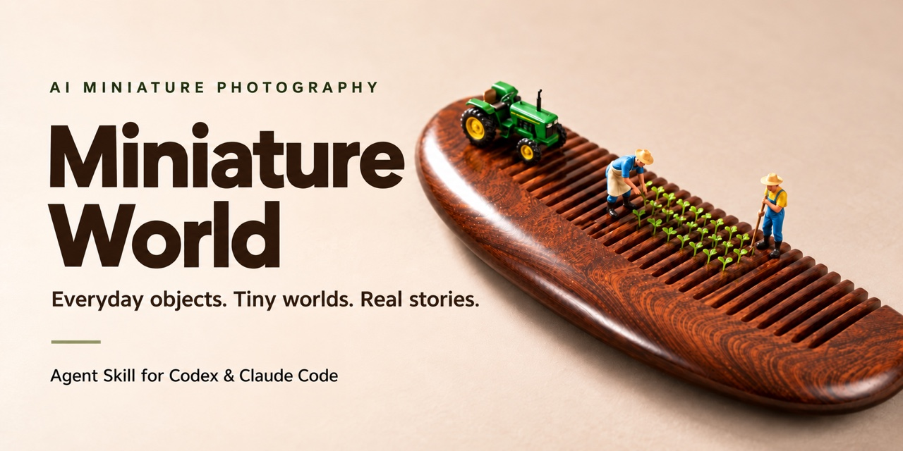

<a href="README.md">English</a> · <a href="README.zh-CN.md">简体中文</a> · <a href="README.ja.md">日本語</a>

<h1 align="center">Miniature World · Agent Skill</h1>

<strong>Turn everyday objects into tiny worlds with a story.</strong> A miniature photography skill for Codex and Claude Code.

<a href="https://denggui-ai.github.io/create-miniature-world/site/">Website</a> · <a href="#installation-and-your-first-creation">Get started</a> · <a href="https://denggui-ai.github.io/create-miniature-world/site/gallery.html">Gallery (Chinese captions)</a> · <a href="https://github.com/denggui-ai/create-miniature-world/releases/latest">Download</a>

  
  

Notebook & pencil · Bridge · Ice tray · Private pools

AI-made examples: [pencil bridge process](docs/SECONDARY_CREATION.md) · [ice tray concept and review](examples/PLANNING_PHOTOGRAPHY_CASES_20261019.md) (Chinese).

## Start with one object

| What you provide | What you can create |
| --- | --- |
| An object name, such as “mug” | Scenes inspired by its outline, texture or structure; review ideas first or generate directly |
| A product photo | A story linking tiny figures to the object, with its visible appearance as a preservation goal; use photo editing when the image is a suitable base |
| A specific idea | Follow your story without adding extra candidate concepts |
| A text-only request | Concepts or complete image prompts, without calling image tools |

**The object itself becomes the scene.** What the figures do, and why they are there, should relate to its visible structure. Inspired by Tatsuya Tanaka's mitate approach; see [Inspiration and materials](#inspiration-and-materials).

## Installation and your first creation

You need Codex or Claude Code. This is a creative Skill that your agent reads; the website shows examples and does not generate images. **You can start without a photo, and the first request does not call an image tool.**

**1. Install for the host you use**

Download the Skill archive and checksum file attached to the [latest release](https://github.com/denggui-ai/create-miniature-world/releases/latest), then verify and extract them using the [installation guide](docs/GETTING_STARTED.en.md#choose-your-source). Find the `create-miniature-world` folder containing `SKILL.md`; in the source repository it is `skills/create-miniature-world/`.

| Your host | First project-local installation | Instructions |
| --- | --- | --- |
| Codex | `your-project/.agents/skills/create-miniature-world/` | [Host installation guide](docs/GETTING_STARTED.en.md#install-for-your-host) |
| Claude Code | `your-project/.claude/skills/create-miniature-world/` | [Host installation guide](docs/GETTING_STARTED.en.md#install-for-your-host) |

Choose the row for your host. Install the complete Skill folder, not just `SKILL.md` or the whole repository. If a copy already exists, [back it up and compare](docs/GETTING_STARTED.en.md#update-and-report-problems) before replacing it. In a fresh session, confirm which Skill was actually loaded; copying files alone does not prove discovery.

**2. Copy one request — no photo needed**

| Host | Send |
| --- | --- |
| Claude Code | `/create-miniature-world Design miniature photography using an ordinary mug. Show two text-only ideas first. Do not generate images. Please respond in English.` |
| Codex | `Use $create-miniature-world to design miniature photography using an ordinary mug. Show two text-only ideas first. Do not generate images. Please respond in English.` |

Expect written ideas describing which part of the mug becomes what, who is doing what, and where the camera is. There should be no image yet. If the Skill was not loaded, return to the installation guide; if it generated an image at this step, report that behavior.

**3. Choose one idea, then make one image**

With an image tool available, ask “Generate one image from idea 1.” Without one, ask “Give me the full image prompt for idea 1, without generating.” Use it in an image tool you already have. For a later attempt, bring your own product photo and specify what must stay unchanged.

Generation and editing depend on tools actually available in your host; not every Codex or Claude Code environment can generate images. No model, API key or image credits are included. See the [documented verification scope](docs/GETTING_STARTED.en.md#update-and-report-problems).

Describe the resulting scene in one sentence before deciding what to change. Share your experience through the [first-use feedback form](https://github.com/denggui-ai/create-miniature-world/issues/new?template=first_use.md), including installation blockers or an unavailable image tool.

## How to talk to it

| You say | It does |
| --- | --- |
| You choose the idea, make one | Reads the object, compares candidates, picks one and generates when a tool is available |
| Show me the ideas first | Each idea in words: where the camera is, who is doing what, which part of the object becomes what |
| Just give me the prompt | Text only, no generation |
| Edit my real photo | If the photo is taken close to the table with the object large and a clean background, it keeps the photo and only adds figures and props |
| Make the people smaller | Rescales figures and their props, protecting the product |
| I don't get the story | Rechecks the object link, the action and the spatial relationships; changes the situation if needed |

With a product photo or a specified product, preserving its visible appearance is the default goal; a generic object name allows free creation. Square frame by default; any ratio you specify takes priority. Direct creation defaults to two ideas with one image each; a specific idea, a request for one image, or only one viable concept results in one image. One first image per idea; at most one edit, only on the image you name; no retries or automatic extra images.

## How it comes up with ideas

It pictures the shot before making it: where the camera is, what looks huge, how small the people are ("as tall as one hole"), which part of the object becomes what, and what is happening. When ideas run short, it looks through 20 text-only case cards of Tanaka's works and borrows the idea, not the picture.

There are two ways to make the image: with only an object name, the whole picture is generated; with a photo taken close to the table and the object large in frame, it keeps your photo and only adds figures and props. Afterwards it asks you one thing, "what is this scene?" If you read the story at a glance, it worked.

## More examples and tutorials

- [English first-use guide](docs/GETTING_STARTED.en.md#follow-the-examples), which introduces the case tutorials
- [Orange photo → planet survey](https://denggui-ai.github.io/create-miniature-world/site/orange.html): two concepts, then one edit to shrink the figures (Chinese)
- [Remote control photo → two results](https://denggui-ai.github.io/create-miniature-world/site/remote-control.html): one real photo, two tiny worlds (Chinese)
- [All cases and reviews](examples/README.md) (Chinese)

## Requirements and limits

- **Works best** with objects whose outline, texture, structure or opening suggests something else; a product photo helps. Success is not guaranteed by category, and the product's structure is not changed for the story.
- **Product fidelity**: lettering, parts and proportions can still come out wrong, especially with direct generation. An appealing idea is not an exact SKU match.
- **Figures**: scale follows the relationship between a person and a part of the object, not millimetres. Three bundled figure photos are style references only ([notes and license](skills/create-miniature-world/assets/figure-refs/README.md), CC BY-NC 4.0).
- **Local finishing** runs only on request and needs Python 3, Pillow and NumPy; otherwise the original is delivered.
- **What has been verified** for each version is in the [release notes](https://github.com/denggui-ai/create-miniature-world/releases) and the [validation log](docs/VALIDATION.md) (Chinese). Other machines, other platforms and implicit desktop triggering are unverified; no stable success rate is claimed.

## Inspiration and materials

With appreciation for [Tatsuya Tanaka / MINIATURE CALENDAR](https://miniature-calendar.com/about/) and the possibilities of mitate. This project's method is its own synthesis of visual study and experiments, not the artist's published workflow; the case cards contain text and links to the artist's own article pages only, with no copied images. [Preiser](https://www.preiserfiguren.de/) is a useful official reference for figures and poses.

This is an independent project, with no official affiliation or endorsement from the artist, MINIATURE CALENDAR, Preiser or the product brands shown in examples. Code and original text use the [MIT license](LICENSE); images and third-party materials are not automatically covered, see [THIRD_PARTY_NOTICES.md](THIRD_PARTY_NOTICES.md).

## Versions, feedback and maintenance

The current version, archive, SHA-256 and release notes are on [Releases](https://github.com/denggui-ai/create-miniature-world/releases/latest). Report problems with the [issue template](https://github.com/denggui-ai/create-miniature-world/issues/new?template=bug_report.md): host, loaded version, input, expected and actual result; share only images you may share and never credentials. Maintainers see [MAINTAINING.md](docs/MAINTAINING.md); the only source is `skills/create-miniature-world/`, and installed folders are copies.

Project listing materials: [Chinese/English summary and walkthroughs](docs/SHARING.md).
