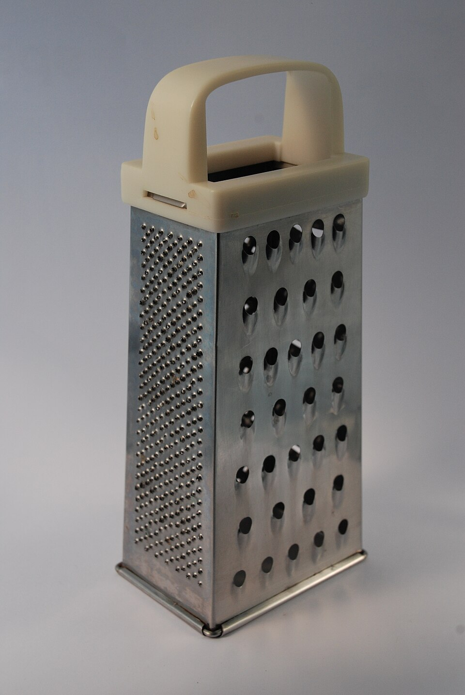
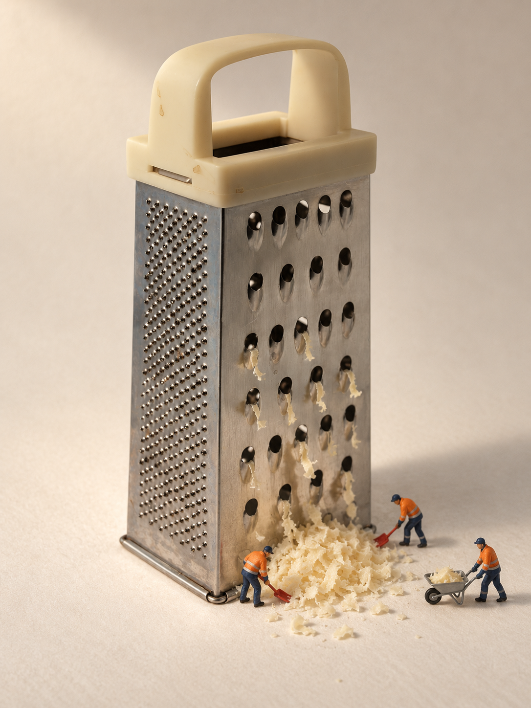
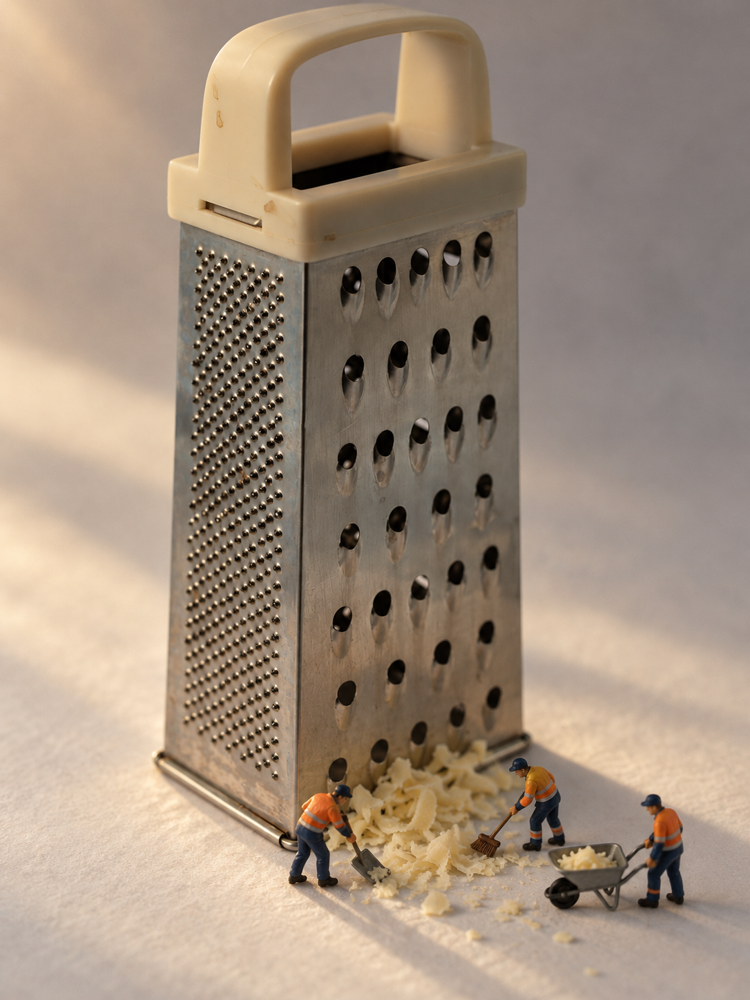

# 刨丝器：两种拍法的真实参考验收

2026-10-13；AI 生成与本机颗粒后期。两张都使用同一张真实刨丝器照片，商品外观为保真模式；不是品牌官方商品图。

## 实际输入

**Grater — Ben Dalton / noii, CC BY 2.0, via Wikimedia Commons.**

- [来源照片页](https://commons.wikimedia.org/wiki/File:Grater_(3792844780).jpg)，摄于2009-08-05；[CC BY 2.0许可](https://creativecommons.org/licenses/by/2.0/)。
- 实际输入是 Commons 提供的同一完整照片960×1434版本，下载后未裁切、改色或修图。不是完整下载原始3.2MB文件；本次文件的SHA-256见下表。
- 两次同时传入本包的 `figure-bending-worker.jpg`，只参考人偶涂装质感；摄影作者 denggui-ai，CC BY-NC 4.0。该照片不是商品参考。
- 原照片可见浅米色塑料拱形把手、宽顶框、旧痕、正面交错大孔、左侧细密孔、转角接缝与金属卷边底框。品牌、SKU、尺寸及隐藏面未知。

## 原图与后期分开

| 田中风格 | 实拍光影 |
|---|---|
|  |  |
| [原图](grater-tanaka-original-20261013.png) · [后期](grater-tanaka-finish-20261013.png) | [原图](grater-real-light-original-20261013.png) · [后期](grater-real-light-finish-20261013.png) |

各一次内置生图，2成功、0重试、0生成式修改。两图都为1086×1448、不透明RGB PNG、3:4。后期由源码 `photo_finish.py` 另存，均 `--dof none --grain 3.5 --seed 0`，只加预设颗粒；这个seed仅属于后期，不是生图seed。

田中风格用米白纸与暖柔主光；实拍光影用低角度暖侧光、长影和已有前后虚化。两个新会话独立选案，都选择工人清理、运走奶酪积雪；不是一张图换光的控制变量比较。

## 实际验收

用户对照参考照及两案原图/后期，回答明确的“商品外观保真、故事可读、人偶大小、美感是否都过关”问题，原话：**“两张四项都过关。”**

- 可见主体保留米色塑料把手/框架、旧痕、顶口和侧槽，粗细孔面的朝向与金属底框；未改成全金属把手或黑胶底。
- 工人铲、扫、推车清理底部奶酪碎屑的动作可见。人物目测田中约7–9%画高、实拍约8–11%，不认证真实毫米比例。
- 保留的观察限制：田中图下部孔和部分底缘被奶酪遮挡；实拍图顶部留白紧，部分孔口/凸刃、把手线痕、金属划痕与色斑重绘。精确微孔数、间距、纹理逐点对应、隐藏面均未认证。
- 此结论只对应本次两张的可见外观与四维验收，不能推断任意商品、准确SKU、全部文字或量产尺寸均可靠。

运行文件从源码 `9085b9f2eff2ec1346b0b23bad8e4e49b420b908` 导出；两案22个运行文件SHA-256一致，工具记录确认每案都传入商品照与人偶参考。原生生成图与本页原图字节一致，实际输出逐张看过；回执和原始运行记录保留于开发证据，不随公开包附带本机路径或原始工具响应。

## 文件校验与许可

| 文件 | SHA-256 |
|---|---|
| `grater-reference-20261013.jpg` | `8193dd2874555b2874213ba52dd664814d87fb50176d600cc665322c0512b2d1` |
| `grater-tanaka-original-20261013.png` | `365c0e6029653b1c76e426f2e1400ded20b7a1c101218767bee9510cc3892fed` |
| `grater-tanaka-finish-20261013.png` | `b69b284f2a8a6c4a98cbffe3deb6c51ead94e417e5df95eb2b233512b527543e` |
| `grater-real-light-original-20261013.png` | `9768d136417bec844353ca109b8842ac99c07fb48f0cfd3b418231cb071ab0b9` |
| `grater-real-light-finish-20261013.png` | `9ff0607d20dcebfb5c04ea760609c78377773f34734456cd084101925e96e30e` |

真实参考照沿用CC BY 2.0和上述署名，不通过MIT重新许可。AI成图/后期不纳入MIT，本项目仅展示验收与能力，不提供额外商用、修改或再分发授权；实际输入素材及模型人偶造型权利不因AI生成而消失。代码与自行编写文档仍为MIT。
