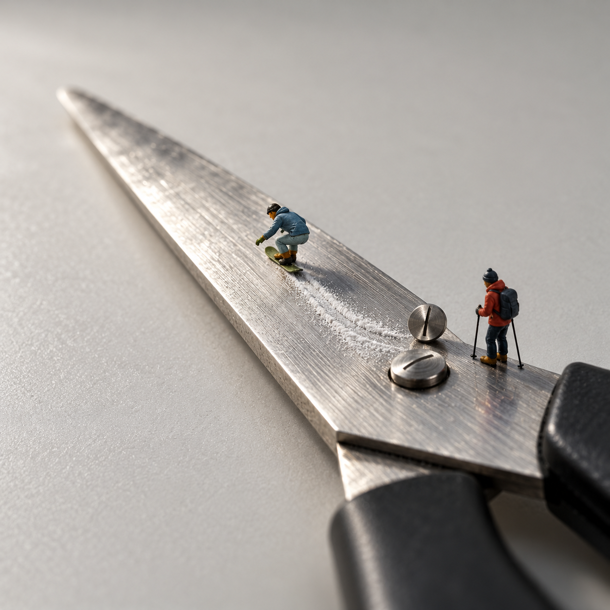

# v0.2 图卡版案例：刨丝器、回形针、剪刀（2026-10-20 至 10-21）

v0.2.0 与 v0.2.1 行为测试中按 Skill 流程实际出的 5 张图：先写一张图卡（相机在哪、什么巨大、谁小、哪个部位成了什么、发生什么事），再走“直接生成”路线各出 1 张，0 编辑、0 后期。成图后只问用户一句“这是什么场景”，下表照录用户第一读。2026-10-21 按用户授权公开。这些是有限试用记录，不证明稳定成功率。

| 成图 | 物件与读法 | 输入 | 用户第一读 | 已知不足 |
| --- | --- | --- | --- | --- |
|  | 回形针 · 跨栏赛：外圈是栏架，直边是栏腿 | 只有物件名称；包内人偶照片作造型参考 | “高尔夫和跨栏比赛”（与同批高尔夫一起看） | 人偶有五官和肌肉，偏写实手办感，未做到哑光平涂 |
|  | 刨丝器 · 果岭推杆：大孔是球洞，孔唇是杯口 | [CC BY 2.0 刨丝器照片](grater-reference-20261013.jpg)；包内人偶照片 | “高尔夫和跨栏比赛” | 刨丝器被重绘：孔形变圆、列数变少、钢面抛光感过强；人偶偏精细 |
|  | 刨丝器 · 孔洞旅馆：一个孔一间房 | [CC BY 2.0 刨丝器照片](grater-reference-20261013.jpg)；包内站立人偶照片 | “爬墙探索”（图卡原想读成入住胶囊旅馆，读法成立但没落在图卡事件上） | 孔形从水滴变椭圆、小刺变粗；人偶精细 |
|  | 剪刀 · 刀面滑雪：拉丝刀面是雪道 | 用户自拍剪刀照（不公开，底图准入四条均不过，故走直接生成）；包内弯腰人偶照片 | “滑雪和跑步比赛”（两张一起看） | 剪刀被重绘且比原物干净，刀轴螺丝变样；人偶精细 |
|  | 剪刀 · 柄环接力：椭圆柄环是跑道 | 同上；包内站立人偶照片 | 同上 | 柄环形状变细长；人偶偏大偏精细；举旗观众是图卡外的添加件 |

共同结论：图卡写的事件在 5 张里有 4 张被用户一眼读出；直接生成路线的商品重绘和人偶精细度仍是生成器不听的项，改措辞无效，要靠编辑实物照路线（需合格底图）解决。

来源与许可：生成图不纳入 MIT，仅作本项目展示和教学，不提供额外商用或再分发授权；刨丝器照片署名“Grater — Ben Dalton / noii, CC BY 2.0”；人偶照片 CC BY-NC 4.0，见[素材说明](../THIRD_PARTY_NOTICES.md)。没有田中达也原作作为生成输入。
