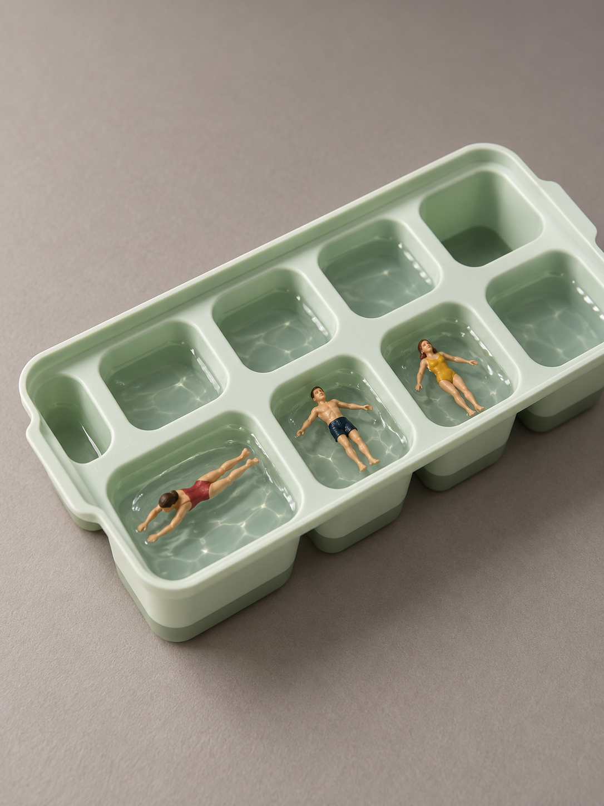
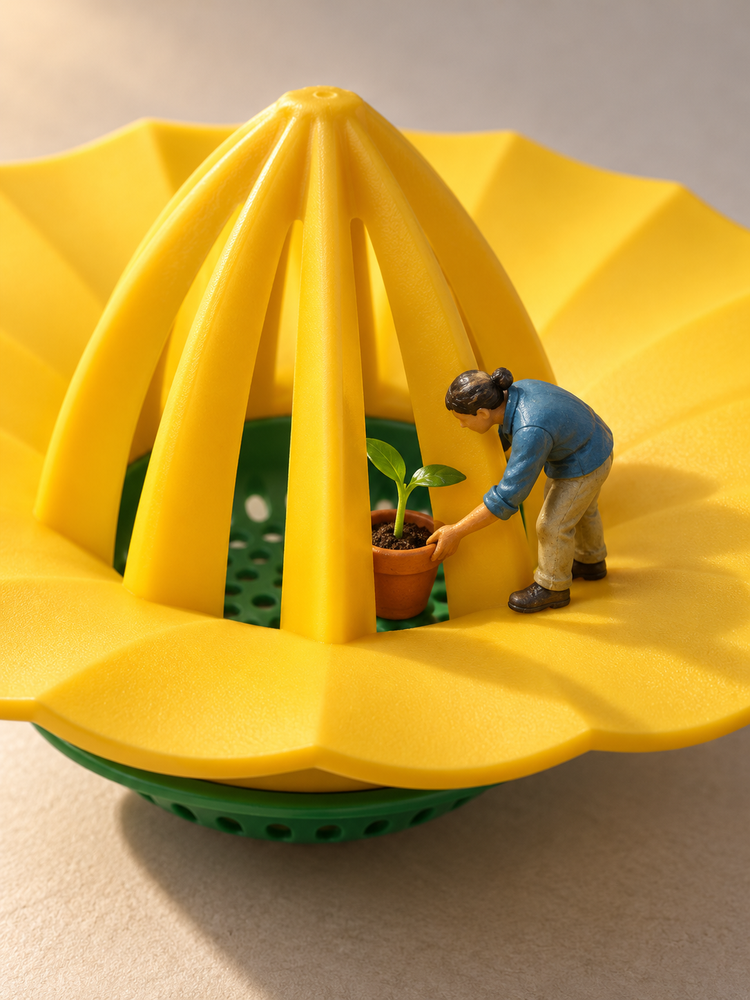
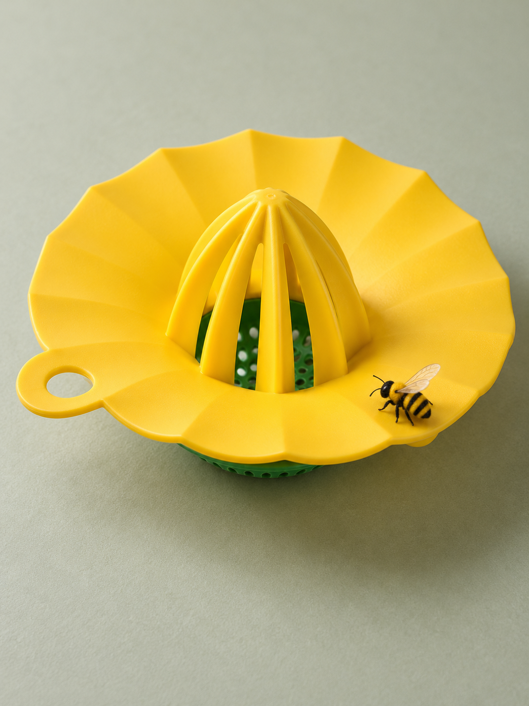
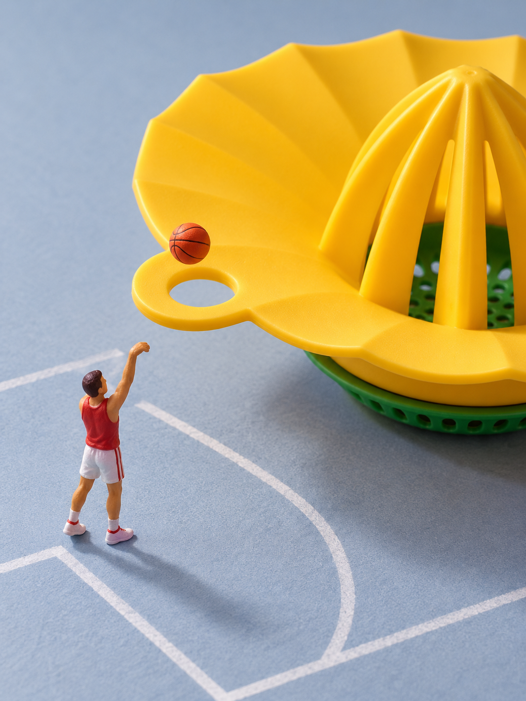

# 从物件到画面：两次策划与摄影取舍

2026-10-19公开。复用10月18日至19日的实际策划和四张初图，展示候选、取舍、拍摄决定与结果。本次整理没有追加生成、编辑或后期。以下为知情主会话评估，用户反馈单独标明，不是新旧版盲测或稳定成功率证明。

商品输入是官方照片，本页说明来源与可见事实，不转载官方原照。四张展示图均为AI生成，无田中达也原作输入；人偶参考为项目作者实拍，仅提供模塑轮廓与涂装，不证明真实型号或商品相对比例。图片用途见[来源与许可](../THIRD_PARTY_NOTICES.md#planning-photography-cases-20261019)，品牌名称仅描述测试输入，不代表合作或背书。

实际人偶输入：冰格与榨汁器C使用[站立成人实拍](../skills/create-miniature-world/assets/figure-refs/figure-standing-adult.jpg)，榨汁器A使用[弯腰成人实拍](../skills/create-miniature-world/assets/figure-refs/figure-bending-worker.jpg)；B未使用人偶参考。两张照片的署名与许可见[包内参考说明](../skills/create-miniature-world/assets/figure-refs/README.md)。

## 案例一：冰格的分装秩序，成为一人一池

### 实际输入

[IKEA SPJUTROCKA 冰格，404.295.80](https://www.ikea.com/se/en/p/spjutrocka-ice-cube-tray-with-lid-mixed-colours-40429580/)。实际查看官方全貌与开口细节两图，选浅绿盘、正常取下盖子的状态。可见两排各五个圆角方格、连续隔筋、略收格壁与外缘；背面、格内净尺寸未实测，不从整机尺寸反推人偶毫米比例。

### 三个候选与原先的推荐

| 候选 | 联系与观看价值 | 粗构图与选择依据 |
| --- | --- | --- |
| A 一人一池 | 盛水分装成为每人独享的私人泳池，重复秩序产生幽默。 | 斜俯视，相邻三格各有泳客，隔筋、水面、姿态同框；可能只像冰格摆泳客。 |
| B 厨房考古探方 | 方格成为分区发掘空间，容器与泥土产生反差。 | 两格砂土、陶片与刷土者；较依赖外加道具与身份，深壁可能挡住动作。 |
| C 一格北冰洋（无人） | 一格水、浮冰与小船，把遥远冰海收进厨房器皿。 | 取一格及相邻边框，冷侧光分开冰与水；可能仅像冰块配玩具船，尺度发现尚不确定。 |

纸面推荐并经用户选择A：分隔、重复与盛水用途共同支持新读法，比B更少依赖外加身份，比C更有可见重复对照。B/C未生成，不能记为图像失败；无人不是C未选的理由。

### 所选方案怎样拍

- **摆位与表达：** 开盖浅绿盘正常正放，三位泳客分处相邻三个水格，身体朝向有变化，水面互不跨墙；其余格留空或盛水，不另造整套池边建筑。
- **机位与取景：** 竖幅3:4、中高斜俯视，长轴斜入画，重心为泳客—水面—隔筋。优先保关系大小，可裁远端，代价是完整十格不能全部核准。更低视点可能挡住水面，这是推演风险，未另拍对照。
- **光线与清晰范围：** 左上柔侧光、弱正面补光分开水线与塑料，反光避开泳客；三位及对应格口同时可辨，远端可退后，暖灰纸面支持休闲气氛。
- **保留项与首图问题：** 不改大格口、不合格、不切墙；先看“一格一个人”是否产生发现，再查结构和造型。另输入一张成人实拍供造型，未输入泳姿或同场景比例参考。

### 实际成图与判断



三人分处独立水格，重复排列与闲适姿态支持原定趣味；斜俯视同时呈现泳客、水面和隔筋。用户原话“是的 这个效果不错”，仅记录本图整体效果认可。

右端出画，完整十格及逐列关系未全部核准；边缘厚度、底部色带、格壁截面未逐项验收。人偶面部、头发与身体细节仍较细，未认证精确模型造型或物理比例。当前为获认可创意初稿，不称严格商品正式成片。

## 案例二：榨汁器先选小亭，出图后改推球场

### 实际输入

[IKEA UPPFYLLD 柠檬榨汁器，905.286.91](https://www.ikea.com/us/en/p/uppfylld-lemon-squeezer-bright-yellow-bright-green-90528691/)。实际查看官方组装全貌与细节两图：黄色花瓣起伏盘沿、水平挂耳圆孔、镂空锥形肋架和绿色穿孔滤网。完整背面、卡扣、拆装与精确净空未知。

### 三个候选与原先的推荐

| 候选 | 联系与观看价值 | 粗构图与当时的风险判断 |
| --- | --- | --- |
| A 一株植物的阳光亭 | 肋架成为给一株苗的“大建筑”，园丁从外照料，形成温暖里外关系。 | 初拟较低斜视，苗和手对应同一肋间开口，侧后暖光显通透；开口、承托未知，可能像网罩。 |
| B 蜜蜂来访（无人） | 黄色花瓣轮廓配小模型蜜蜂，形成花与访客的对应。 | 较高斜俯视保全轮廓，柔侧光显起伏；可能只是蜜蜂停在工具上。 |
| C 挂孔球场 | 真实挂孔成为篮圈，小部件承担另一世界的用途。 | 挂耳侧近景，孔口朝上、球在孔上、人站纸面；当时担心运动线索小，局部削弱认物。 |

当时推荐A，认为肋架、内庭和开口共同支持空间，也较少依赖极小运动线索。用户先选A，后授权B/C各一张，最终三案各1初图。C原名“挂孔里的三分球”，成图不能证明投篮距离，后改用本标题。排序变化不能倒写成一开始就选对C。

### 摄影怎样发展，实际看见了什么

**A的细化改变了初案机位。** 为同时看见苗、手、开口，改为较高斜俯视，盆靠前、园丁侧移，手在盆口下部、叶片在开口上方。裁部分盘沿，保留连续肋条，不靠删肋、封网换可见性。左后上主光与前补光支持通透与照料感，清晰组为手—盆沿—苗叶—两侧肋条；盆和脚的实际承托仍需核对。



三者清楚，暖光与照料动作有情绪依据；但也容易读成网罩内整理盆栽，小亭身份较弱，黄色大锥体吸引注意。可见性改善不等于原定发现全部成立；保留情绪价值，不改称故事追认成功。

**B保留静态对应。** 较高斜俯视、柔侧光，蜜蜂落在前侧偏心盘沿，接触处可见；没有人物，也未传人偶参考。



花形对应有依据，当前发现较轻，昆虫细节偏仿真；不因无人或静态判失败，也不因简洁漂亮自动主推。

**C把小挂孔移到重心。** 商品正立、孔口水平，不另造篮架；人站独立纸面，球在孔上方，抬手朝向孔口。局部侧斜近景保留部分黄盘、肋架和绿底作认物线索，蓝灰纸面与红白人物组织主次，孔、球、投篮朝向同时可辨。代价是完整商品退出，实际图不证明精确执行了标称机位。



挂孔直接承担篮圈作用，知情评估改为 **C > A > B**。C只支持投篮，不证明三分或入篮；人物衣饰和四肢较细，精确模型造型待验。A/C各另输入一张包内成人实拍供模塑与涂装参考，不提供相对尺度。三图黄绿主要构型可辨，肋缝、滤孔排列、挂耳比例与截面均未完成严格验收。排序为助手评估，没有用户对三图逐项质量通过的记录。

## 两案能支持的经验与边界

冰格显示分格、用途与重复可以共同支持观看价值；榨汁器显示能同框、光影漂亮仍不足以保证推荐最优。联系、摆位、摄影、生成制作应分别诊断，实际结果须能改变决定。

静态、无人、局部、延迟识别和合理多义继续允许；不从两案导出固定人数、白底、柔光或动作要求。商品保真、艺术效果与用户反馈分别判断，本页不证明稳定提升或田中风格普遍成功。

## 图像记录

四图均1086×1448、3:4，各1初图、0编辑、0后期。此处为原始PNG逐字节副本，无EXIF或文字元数据；官方商品照不随本页分发。AI图片不纳入文档的MIT许可，不增加商业或再分发授权。

```text
9f56daaa3adc9daaf6878de6cd311c1fda60fa1435abdbd14c077f2e3ddcdd5b  ice-tray-private-pools-20261019.png
716936d6b375a1acecbc2a07d1e9b0a41c258edcb3cf6bbc97431795868bf270  citrus-squeezer-pavilion-20261018.png
496ce995a4e55653d6e8b02b1afaf32b5c59b56982b2380147106e79c7a388f8  citrus-squeezer-bee-20261018.png
4345f9147fcbfed6788057ffc91593849bb315fcc3c7f4d2d035c13ec9186635  citrus-squeezer-basketball-20261018.png
```

[返回案例索引](README.md) · [代表案例与已知不足](SELECTED.md)
