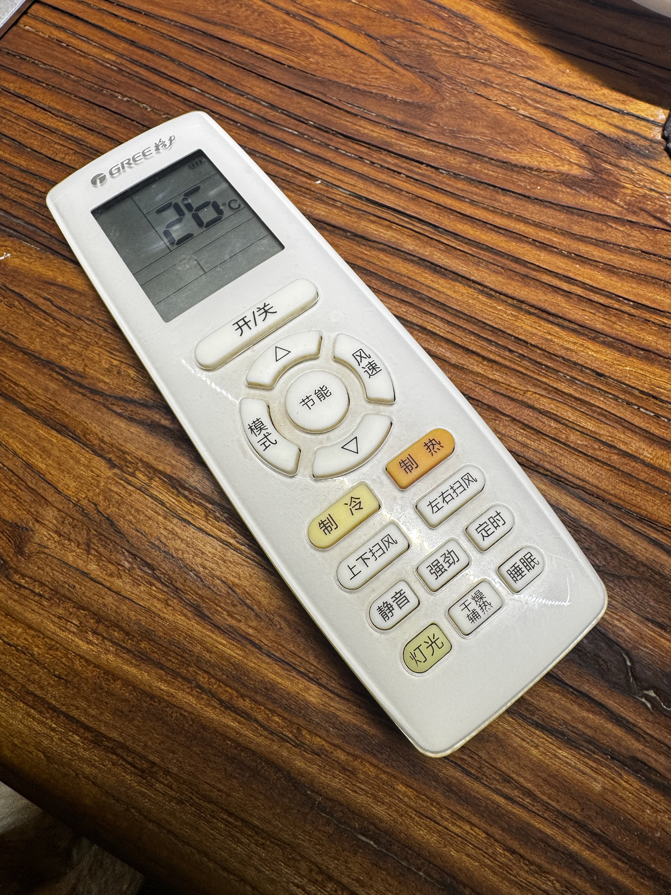
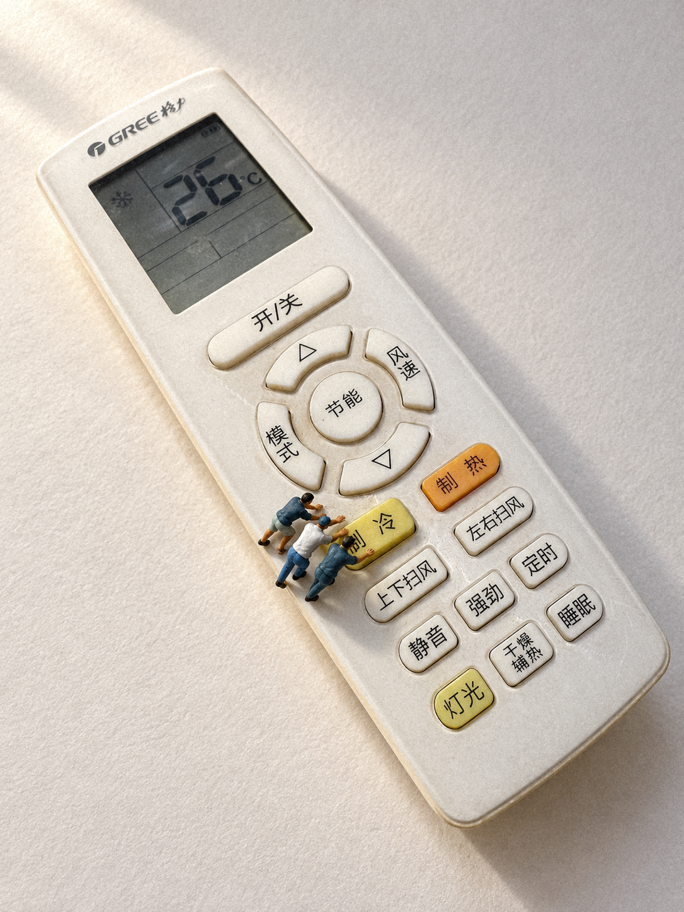
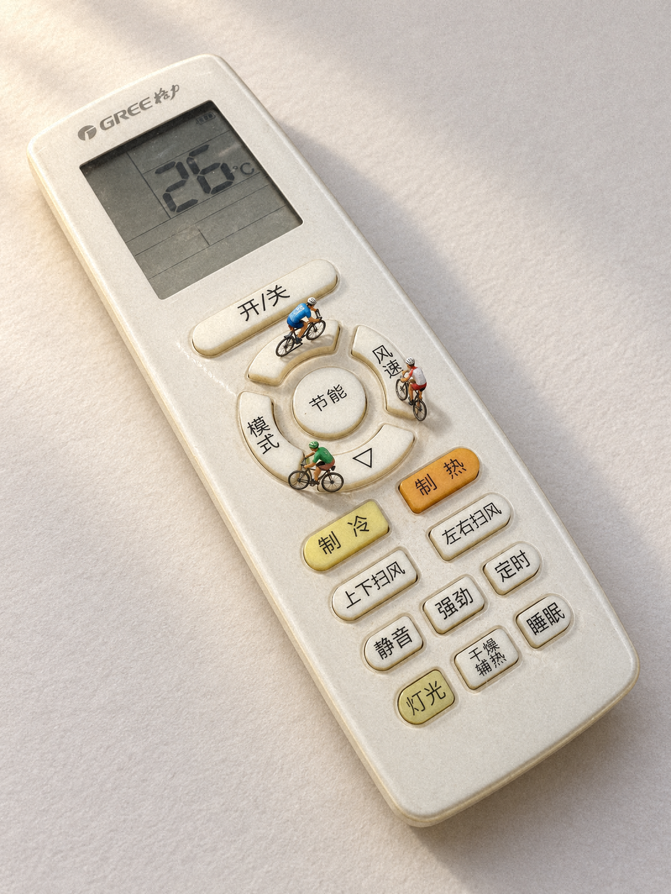

# 空调遥控器：一次真实参考图实测

2026-10-14；v0.1.0运行内容。真实商品照片 → 两个独立创意 → 内置AI生成 → 本机轻颗粒后期。本例展示完整输入与结果，以及仍未解决的偏差。

## Before：实际商品输入

用户上传照片后请求“你是否可以拿这个测试一下”，随后明确选择“实际生成两张，测试参考图保真”。本次输入的事实包括：GREE格力标识、灰色LCD中的26°C、白色长圆角外壳、泛黄和使用痕迹、中心“节能”圆键及四块弧形键、浅黄“制冷”与橙黄“制热”键，以及其余中文按键的排列。尺寸、型号和隐藏面未知；照片中的木桌是背景。

实际传入工具的是用户照片的原文件。公开副本以jpegtran进行完整、无裁切的90°无损转正，去除EXIF和注释，保留ICC色彩配置；公开副本3024×4032。此处理用于公开显示与元数据清理，没有重新拍摄或修图；公开副本与实际输入的文件摘要不同，见下表。原件仍保留本机。

## After：两个创意，同一条拍法

| ① 降温要全队出动 | ② 节能环岛 |
|---|---|
|  |  |
| 遥控器成为巨型温控操作台；三名工人集中向“制冷”键施力。 | “节能”圆键与四块弧形键被读成环岛和分段骑行面。 |
| [查看完整图片](remote-cooling-finish-20261014.png) | [查看完整图片](remote-cycling-finish-20261014.png) |

两张均为默认**田中风格**：米白纸面、偏暖柔主光、短接触阴影。不是两种拍法比较，也不是同一张图只换光线。

每次实际输入同一商品照，并分别传入包内弯腰劳作/骑车人偶实拍，只参考涂装质感；不据此认证Preiser型号或真实毫米比例。两次内置image_gen调用，2成功、0重试、0生成式修改。原生输出各1086×1448、RGB PNG、3:4；生成原图字节原样保留本机。

本页公开的两张After是另存的后期版：`photo_finish.py --dof none --grain 3.5 --seed 0`，仅加轻颗粒。两张焦点行参数分别为0.6和0.44，但none分支不加虚化；seed仅属于后期，不是生图seed。模型名、生图seed工具未提供。实际调用提示见[提示词记录](prompts/remote-control-20261014.json)。

## 对照后的真实结论

| 维度 | ① 降温要全队出动 | ② 节能环岛 |
|---|---|---|
| 商品外观 | 整体身份、屏幕数字、主要键序和冷热配色基本保留；LCD左侧新增了原照没有的雪花图标，字体、键形和磨损重绘。**严格保真未通过。** | 整体身份、屏幕数字和主要键序基本保留；部分键形、字形、间距和磨损重绘，骑车人遮挡局部。**严格逐细节保真未通过。** |
| 故事与接触 | 合力按键可读；靠上工人与按钮的实际接触较弱，不认定三人都真正按下按钮。 | 环绕“节能”的联想可读；四块键之间有间隙，部分车轮靠键缘，不能把它当成真实连续可通行的道路。 |
| 人物尺度 | 弯腰姿态投影目测约画高7–9%，未见明显超标；没有同深度站立基准，不认证精确比例。 | 骑行人偶投影目测约画高6–8%，未见明显超标；坐骑姿态不等同站高。 |
| 美感 | 明亮纸面、阴影与完整主体清楚，人物集中。主观创意偏好等待用户评价。 | 环形结构参与构图；自行车细节偏丰富，模型感与主观美感等待用户评价。 |

用户已授权公开原照与本页两张成图，**没有提供四维通过的验收结论**。公开展示不等于商品保真或创意获得认可。流程完成只证明本次参考图输入、两案生成、保存和后期走通；不是跨商品成功率或严格SKU认证。

## 问题怎样归类

新增图标与重绘是本次生成的偏差；已有Skill要求保护商品外观，尚不足以认定是规则缺失。“环岛”的连续通行逻辑应在选案时核对得更严格，是本轮执行偏差。先把这些情况纳入[保真回归](../docs/REMOTE_CONTROL_REGRESSION.md)，本轮不修改运行规则、不升级v0.1.0、不追加生图。

[照着这张照片使用Skill](../docs/REMOTE_CONTROL_TUTORIAL.md) · [网页教程](../site/remote-control.html)

## 来源、授权与文件摘要

参考照片由用户提供，并于2026-10-14明确授权在本项目公开；未取得作者署名或更广泛的许可声明，标作“用户提供并授权公开”。不将照片、AI生成/后期图片纳入MIT，也不附加商用、修改或再分发许可。包内人偶涂装参考由denggui-ai实拍，CC BY-NC 4.0，见[参考说明](../skills/create-miniature-world/assets/figure-refs/README.md)；不授予人偶造型或商标权利。本例与格力、Preiser、田中达也均无官方合作或背书关系。

实际商品输入及生成原图的摘要保留在下表，文件本机留存；公开图片范围为上方三张。无账号配置、微信目录、私人路径或原始提供商响应随本例上传。

| 文件 | SHA-256 |
|---|---|
| 实际商品输入（原件本机留存） | `e469824ab709c5d452c31b9a2cd204d5d77b8e7ced79e58ce2043dfe39618f14` |
| remote-reference-20261014.jpg | `2fdbeeaf4d0dc68d1a2a5c535073cdf560468a010951c3e283b17b6f8997f36e` |
| remote-cooling-finish-20261014.png | `0ca183d8b07814db187944a5446e731bde864da1a76c35007ed0499b28194716` |
| remote-cycling-finish-20261014.png | `8f9c02dd54548202d02d18ef763067424e0de807aee3a7c6b57dbdf73b77f09e` |
| 生成原图①（本机留存） | `3c31ce75b879ffa91c53bc85e3f2a3b1f6ee30db5a48efa626c59d549342dbb4` |
| 生成原图②（本机留存） | `e7adcac13acfac0c65af18494215d72357f33b7a38bb7d1774b75baa061bba3d` |
