# 产品代表案例

## 2026-10-17：订书机与粘毛器人偶缩小修正

| 案例 | 历史原图 | 本次修正版 |
| --- | --- | --- |
| 订书机 · 喂鳄鱼 | 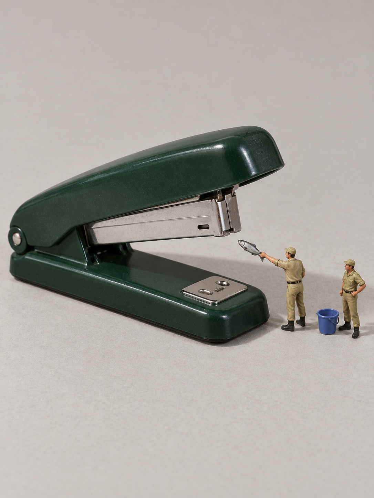 | 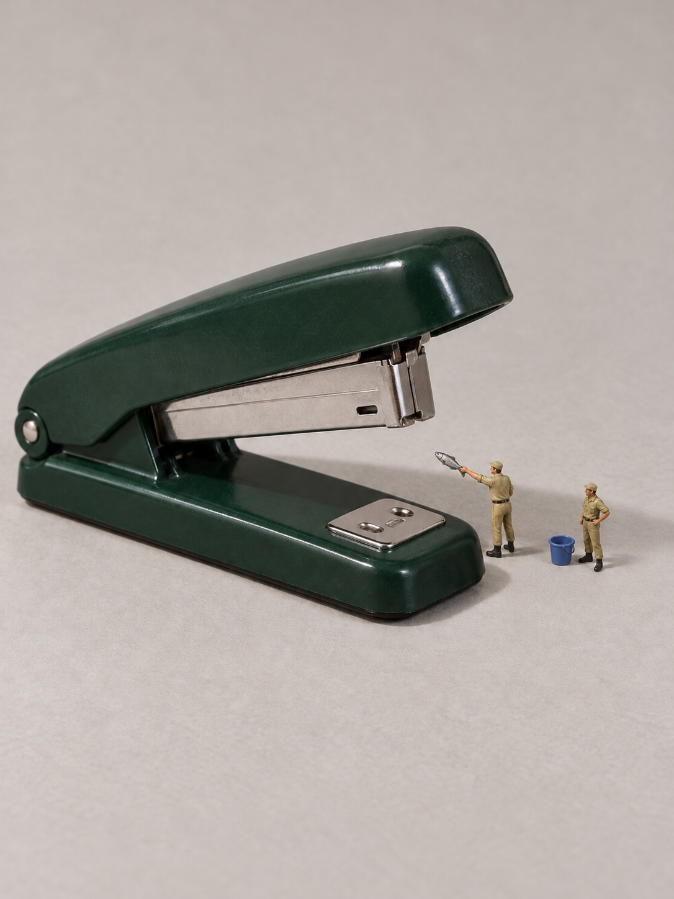 |
| 粘毛器 · 拉手脱困 | 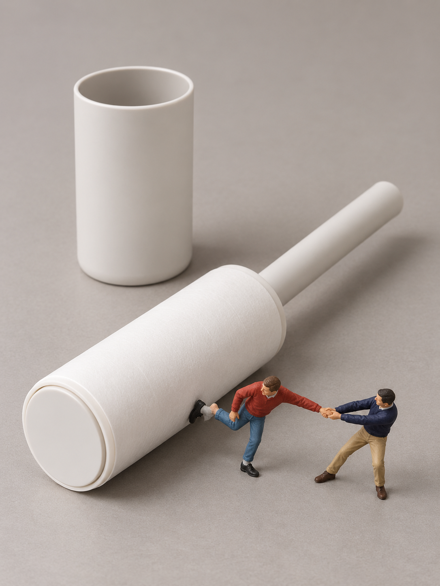 | 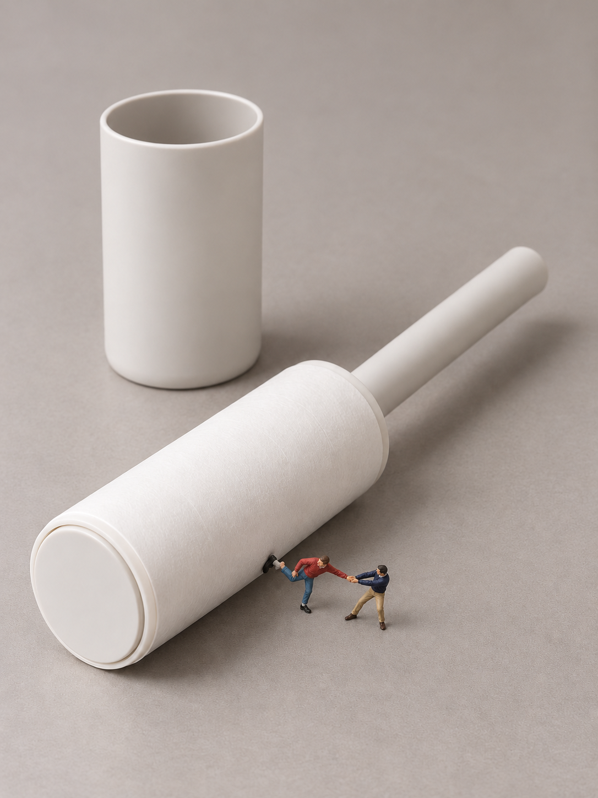 |

两张分别以各自的历史AI成图为唯一编辑输入，各1次内置AI编辑、0重试，无新增商品或人偶实拍参考、无后期，均为1086×1448。用户集中查看两组对照后回复“认可”，同意公开；原图不覆盖。订书机图库卡片采用修正版，粘毛器仍作为历史能力边界案例展示，不新增图库卡片。

**保留限制：** 订书机的人物及鱼、桶已缩小，但鱼与钉口仍有距离，金属通道局部纹理有变化；粘毛器的鞋底粘住、拉手关系保留，人物站位随接触关系有所移动。两张的本次认可不等于商品严格保真、精确比例或所有历史样张通过。粘毛器既有商品识别缺口也不因缩人编辑而消失。

修正版原始PNG的SHA-256：

```text
b5664289d68261d4d51362e4f84e25910621bf8ace7cf153ea71a806d08073d0  examples/stapler-crocodile-feeding-smaller-20261017.png
3f37157a526ed73c075670de169ffe0f25d13a0375e1fb74601cb4b53492e595  examples/lint-roller-smaller-20261017.png
```

## 2026-10-17：杯柄相框人偶缩小修正

| 历史原图 | 一次编辑后的修正版 |
| --- | --- |
|  |  |

以左侧已有AI成图作为唯一编辑输入，用内置图像编辑工具缩小两个人偶及随身包、相机，保留杯子和拍照故事；1次编辑，0重试，无新增参考图或后期。修正版1086×1448，原图未覆盖。用户看图后的反馈为“效果不错”，据此将修正版用于图库展示；这不是全项目、商品严格保真或精确人偶比例验收。

**保留限制：** 杯身左侧裁切仍在，摄影者落点略有移动；不能声称杯子和场景逐像素不变。历史原图的人物偏大记录继续保留。修正版原始PNG的SHA-256：`64a2ffb35b778be1ff12ec2c4067995c78a1aa3ce5e5f113dd84acbb8781a341`；网站WebP仅为压缩展示副本。

## 历史样张的已知缺陷

下表记录历史原图的已知问题，原图保留作学习对照；杯柄相框、订书机与粘毛器的修正版及用户反馈见上方记录，未处理的图片不会因补说明而修复，也不将“故事可读”当作文字保真或人偶尺度通过。

| 样张 | 已知问题与用途限制 |
| --- | --- |
| [直尺冲线](ruler-finish-line.png) | 尺面数字重复、乱序，不作为准确刻度或文字还原示例。 |
| [透明胶带音乐会](clear-tape-concert.png) | 印字有生成乱码，品牌字样与商品结构未通过严格核对。 |
| [AI人偶诊断图](ai-figure-diagnostic.png) | AI生成诊断图，不是实物参照，不能校准真实比例；不作人偶模型感达标示例。 |
| [杯柄相框](mug-handle-photo-frame-20261012.png) | 人物相对物件偏大，且杯身左侧被裁掉；保留创意，不作微小人物尺度达标示例。 |
| [粘毛器早期图](muji-sticky-roller-v1-20261006.png) | 人物相对物件偏大，不作微小人物尺度达标示例。 |
| [订书机喂鳄鱼](stapler-crocodile-feeding-20261012.png) | 人物相对物件偏大；鳄鱼身份依靠喂食动作，不作尺度或商品细节保真达标示例。 |

## 2026-10-14：遥控器真实参考实测

[原照、两张成图与偏差](REMOTE_CONTROL_TEST_20261014.md) · [使用教程](../site/remote-control.html) · [保真回归](../docs/REMOTE_CONTROL_REGRESSION.md)。两张均为田中风格；严格细节保真未通过，用户已授权公开但未给出四维质量通过结论。以下原有分组与历史记录保留。


## 当前选片补充（2026-10-14）

v0.1.0网站新增2026-10-13真实刨丝器参考验收两张，分别展示田中风格与实拍光影；[完整输入、原图/后期、来源与四维反馈](GRATER_VALIDATION_20261013.md)。这两个展示位来自同一商品，不冒称两个独立商品或SKU。页面现为2张真实参考验证＋8张2026-10-12名称测试＋18张历史代表图，共28张案例图；教程配图另计。

用户明确“两张四项都过关”，范围为两张可见商品外观、故事、人物尺度、美感。局部孔口/纹理重绘、遮挡、未知SKU/隐藏面及真实毫米比例仍保留限制。AI成图和后期不自动适用MIT，不提供额外商业或再分发授权。历史图片、编号、失败与旧选片决定全部保留。

历史选片（2026-10-05）：按用户同意的“每个产品只展示一张成功代表图”整理。原34张是选片池，不是34个独立产品；本轮采用18个产品展示分组，各选一图。其中3个案例用于项目首页，8图用于案例页精选。直尺G24另作带数字错误的创意补充，不列入这18张主案例。

这是用户授权助手择片后的展示选择，不回填成历史逐张认可，也不是全部商品保真验收。分组依据当前外观与题材：同一笔记本系列、海绵系列、订书机系列暂各合并展示；棕色封箱胶带与透明胶带外观、结构及场景角色明显不同，分列。将来核实SKU后可调整，不声称本次已识别18个准确型号。

选择先看原物能否辨认、动作和空间关系是否易读，再看人物相对大小与画面；同产品其他成功版本作为补充，不删除。历史图的实际输入未完整恢复，素材范围见[说明](../THIRD_PARTY_NOTICES.md)。

历史展示记录（2026-10-06）：用户批准以纸胶带压路机v2替换站内图库的封箱胶带展示位。当前18张为17张历史案例＋1张新增AI示意；旧G12原图、编号与来源仍在本页历史记录中保留。新图不属于原70图档案，也不沿用G12身份。

## G52 修正带 · 山地步道（案例页精选）

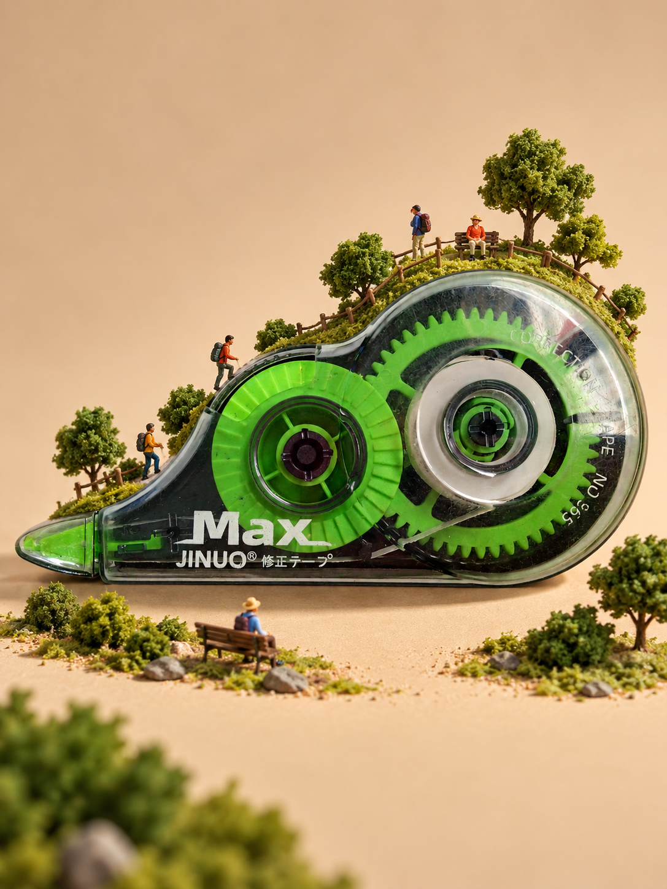

**商品联系与故事：** 弧形外壳形成起伏山路，微缩游客沿路游览。

**已知不足：** 用户曾明确选择此图；细小标识与商品尺寸未验收。

## G46 回形针 · 夹纸冰场（案例页精选）


**商品联系与故事：** 纸张维持夹持身份，长圆回折围出滑行路径。

**已知不足：** 线径、自由端及人偶造型仍需核对。

## G23 木梳 · 齿间农田（首页）

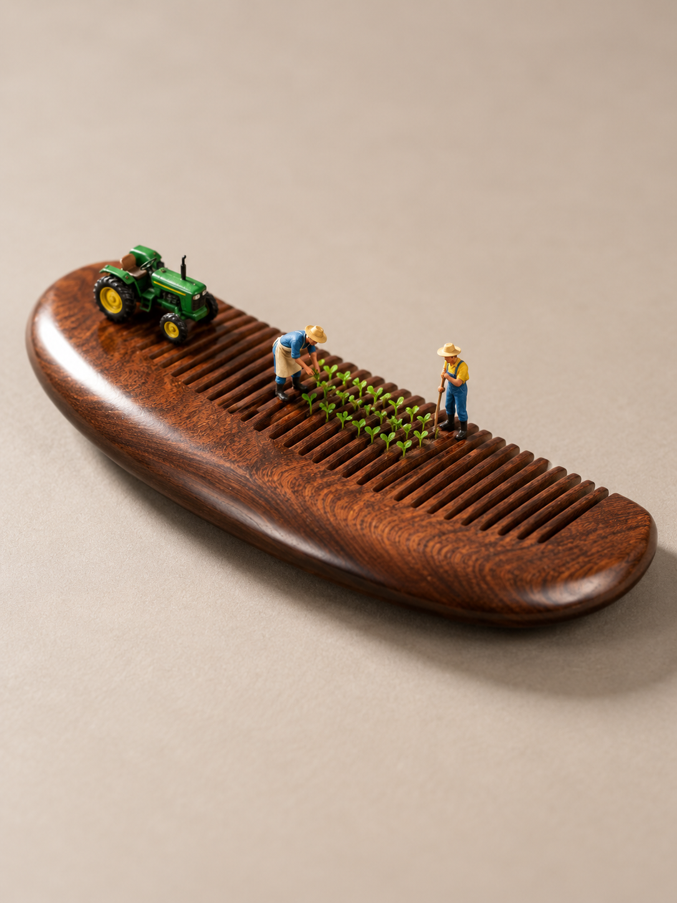

**商品联系与故事：** 平行梳齿如田垄，人物与农具沿齿隙劳动。

**已知不足：** 齿数、长度和厚度尚未逐项与商品输入核对。

## G30 笔记本 · 装订圈停车架（首页）


**商品联系与故事：** 自行车靠近金属装订圈，真实结构承担车架角色。

**已知不足：** 停车可读，不宣称锁车动作或具体SKU已通过。

## G05 眼镜 · 透明屋面维修（案例页精选）

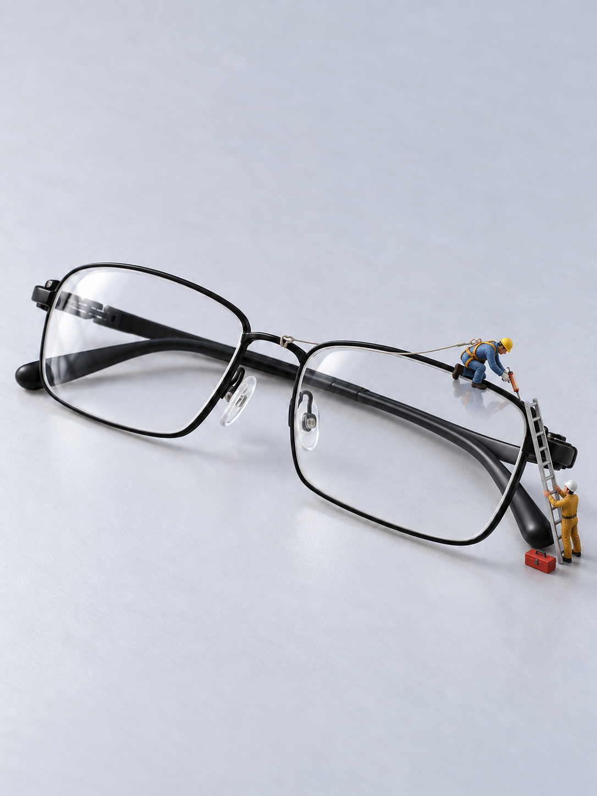

**商品联系与故事：** 倾斜镜片如玻璃屋面，人物在边缘协作维修。

**已知不足：** 接触、绳索锚点与眼镜具体型号尚未完整验收。

## G19 马克杯 · 雨中相遇（案例页精选）

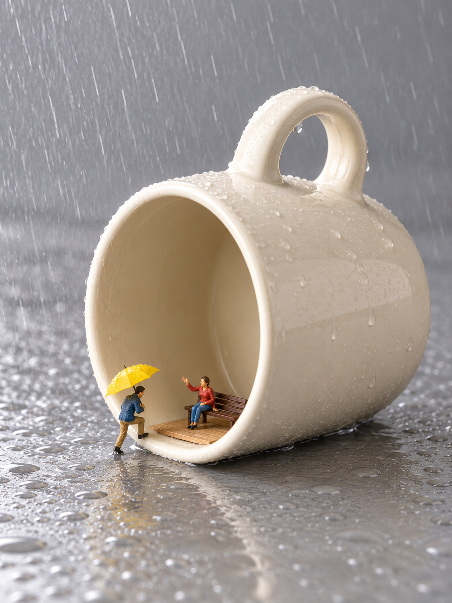

**商品联系与故事：** 侧放杯腔容纳避雨者，人物招呼持伞来者。

**已知不足：** 新增地板、长凳服务情境；杯型保真未配对验证。

## G58 小青柑 · 茶仓装卸（案例页精选）

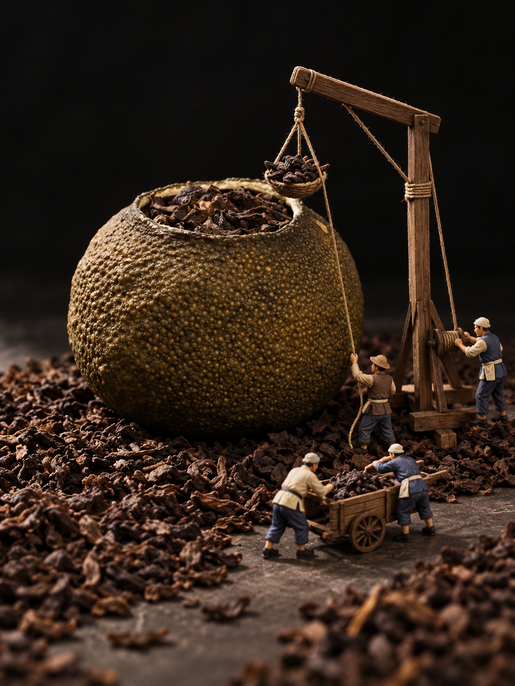

**商品联系与故事：** 柑皮开口成为仓口，人物吊运真实内容物茶叶。

**已知不足：** 商品输入与成图尚未完整配对。

## G70 厨房海绵 · 崖壁与营地（案例页精选）

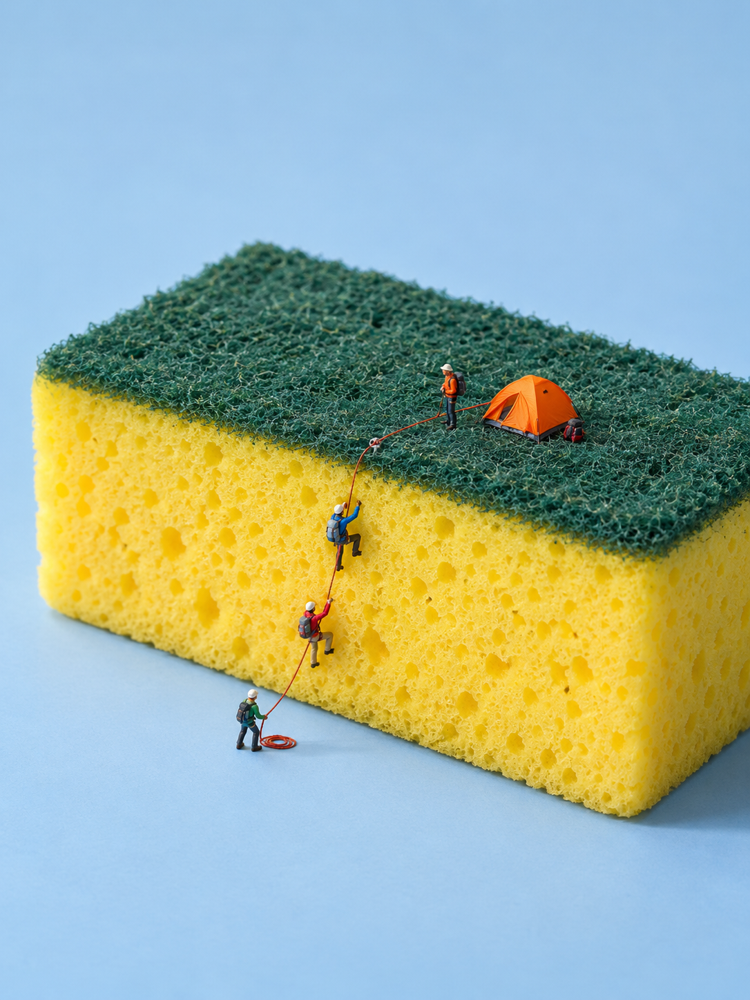

**商品联系与故事：** 黄色孔隙如崖壁，绿色表面如草地，攀登通往营地。

**已知不足：** 人物与道具比例待审；不据此认证真实尺寸。

## 2026-10-06 纸胶带 · 微型铺路

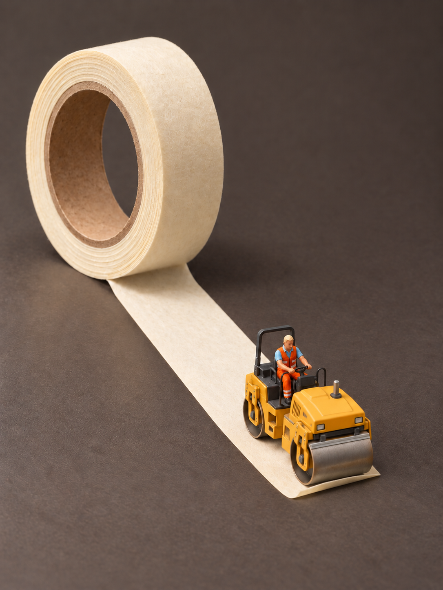

**商品联系与故事：** 展开的纸胶带如一段道路，微型压路机沿条带碾压。用户认可创意与人车视觉关系，并批准以AI生成示意采用。

**已知不足：** 参考造型非认证Preiser型号，精确1:87未验证；“压平翘边”的瞬间仍不明确。不是实物商品摄影或特定模型还原。

**出处：** 本项目2026-10-06纸胶带试验的一次修正v2，原文件名paper-tape-road-roller-test-v2.png，1086×1448；原字节复制为当前英文文件名。SHA-256：49479fe2595a1a2b2ba497ef735756bb3cc2b582a84e515b7b7c26ee3ebfe660。前序两张对照和内部文件身份仅保存在本地测试记录，不公开第三方参考照片。用户批准本项目展示，不据此授予第三方素材或图片额外复用权，见[素材说明](../THIRD_PARTY_NOTICES.md)。

## G15 刨丝器 · 攀岩练习

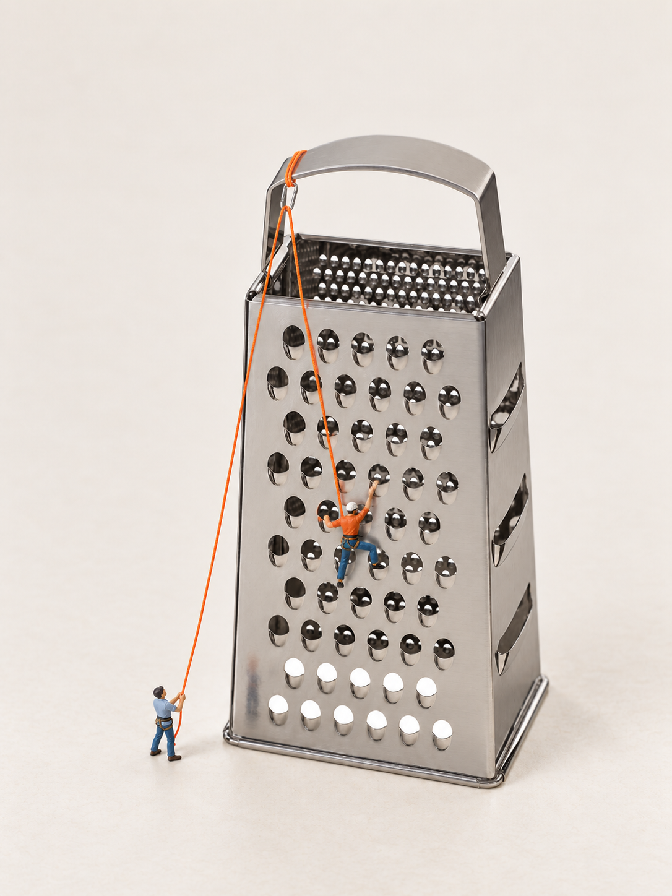

**商品联系与故事：** 真实刨孔成为攀点，顶部绳索与地面保护者构成关系。

**已知不足：** 安全绳路径、手脚接触仍需审图；不是实物使用教学。

## G50 固体胶 · 雪峰登顶

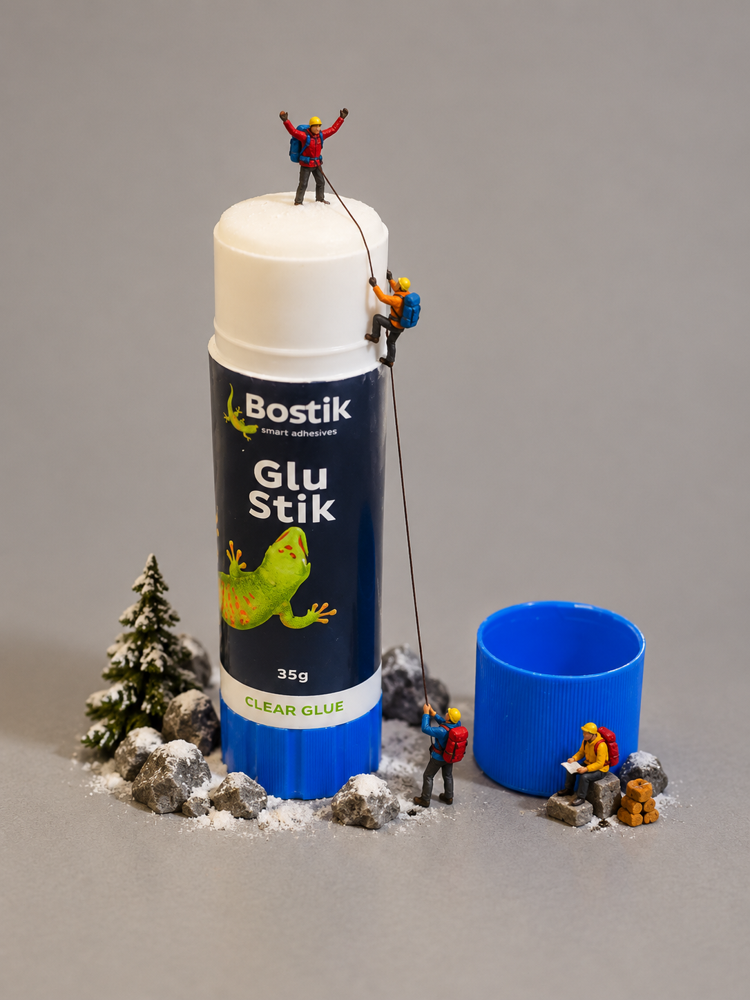

**商品联系与故事：** 白色胶芯如山顶，攀登者抵达顶部、队友在下方协作。

**已知不足：** 已匹配历史试验3-2；不意味着标签逐字或背面保真。

## G54 透明胶带 · 圆环音乐会

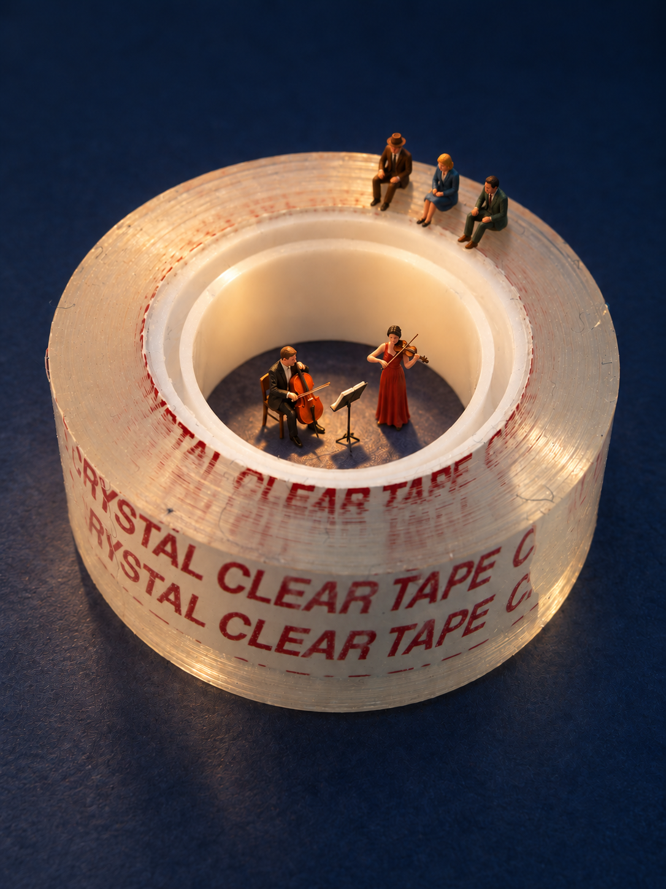

**商品联系与故事：** 中空圆环容纳演奏者，卷边成为观众席。

**已知不足：** 演奏关系可读；印字有生成乱码，品牌字样、商品结构未通过严格核对。

## G56 铅笔 · 石墨公路


**商品联系与故事：** 铅笔留下的石墨痕迹成为道路，工人和压路机参与铺筑。

**已知不足：** 石墨是场景表现；笔身标识与材料保真未验收。

## G60 卷尺 · 跳远测量

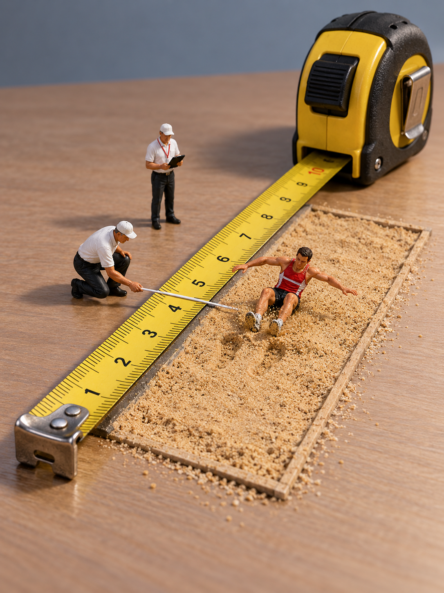

**商品联系与故事：** 卷尺的测量用途与沙坑、运动员、裁判形成联系。

**已知不足：** 尺面数字及测量方向仍需核对。

## G64 长尾夹 · 斜面攀登

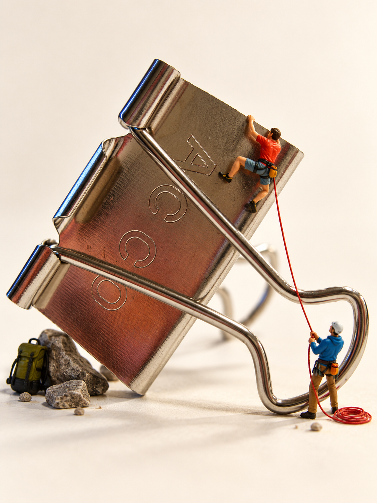

**商品联系与故事：** 金属斜面成为攀登面，双人通过绳索协作。

**已知不足：** 人物偏近；接触和支撑需另审，不作比例标准。

## G65 订书机 · 开口音乐会

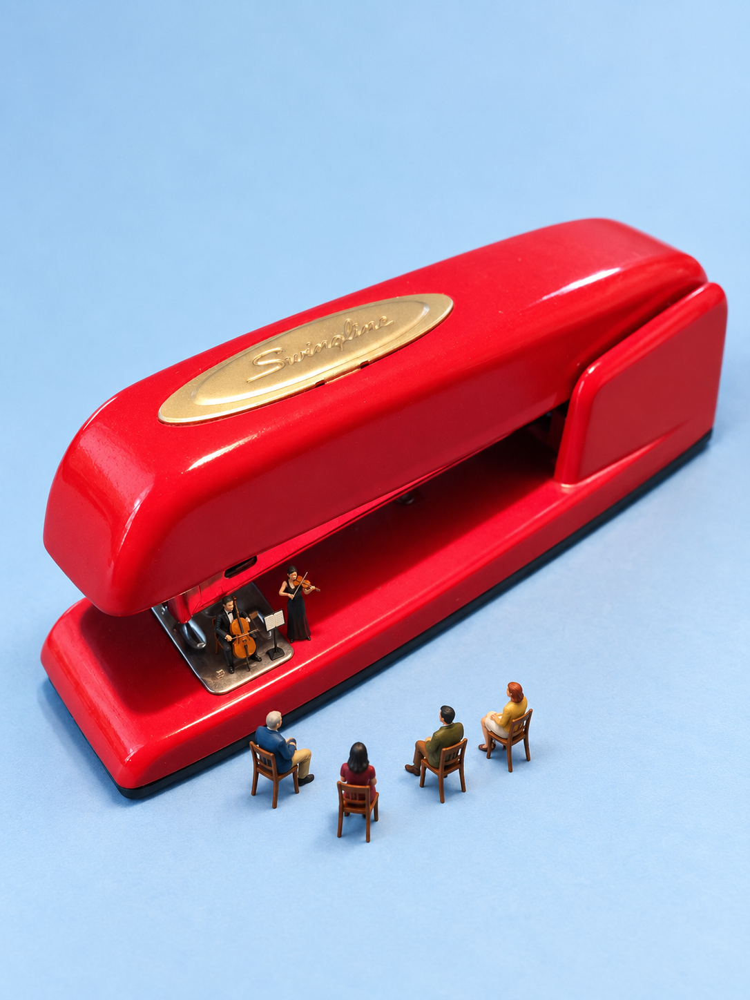

**商品联系与故事：** 开口遮盖演奏者，外侧观众朝向演出位置。

**已知不足：** 品牌字样与开口状态未完成商品事实验收。

## G68 薯片 · 波纹秋收（首页）


**商品联系与故事：** 波纹纹理如田垄，收割机和人物使联想显现。

**已知不足：** 作为食品纹理创意，不认证特定包装商品。

## G69 拉链 · 运河拖船

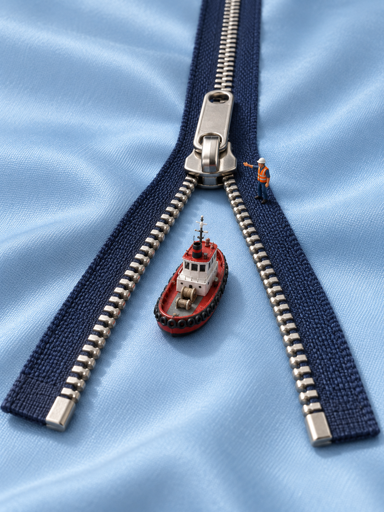

**商品联系与故事：** 拉链分叉与布面构成水道，拖船驶向开合交界。

**已知不足：** 拉链齿、拉头结构和原商品输入未配对验收。

## 历史展示记录

以下G12已退出当前18张图库，原图、身份与来源不变。

## G12 棕色封箱胶带 · 胶带铺路

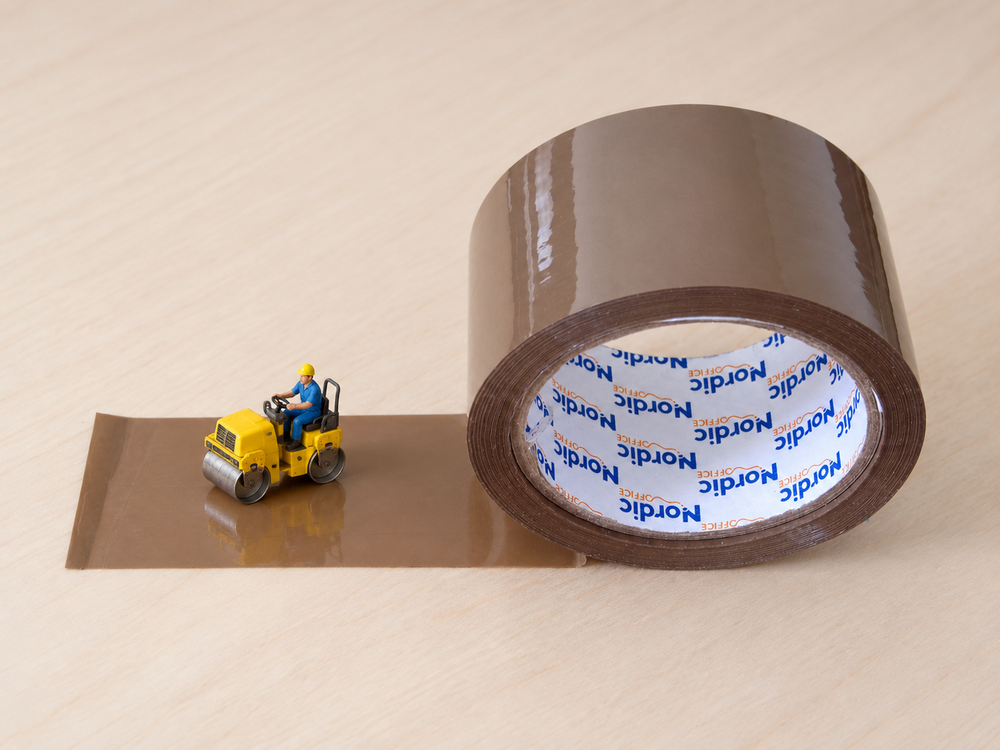

**商品联系与故事：** 展开条带如新铺道路，微型压路机沿表面作业。

**已知不足：** 字样、胶带展开状态与具体参考尚未逐项比对。

## 补充与开发对照

- **修正带G45影院**：[另一种联想](correction-tape-cinema-alternative.png)，保留在详情补充；主代表采用用户明确选择过的G52。
- **直尺G24冲线**：[创意补充](ruler-finish-line.png)，故事清楚但尺面数字有错，暂不作为成功主展示。
- 便利贴学习系列保留在[70图索引](REVIEW_INDEX.md)，待来源配对后单列学习案例。
- 同题材未选版本、失败图及AI人偶诊断仍保留在原档案；已有仓库文件不删除。详见[早期六组复盘](CASES.md)与[人偶说明](FIGURE_REFERENCES.md)。

## 原图溯源

下表保留历史图的G编号、原名和校验值，沿用原70图档案；包含已退出当前图库的G12。新增纸胶带v2的出处、尺寸及校验值单列于其案例段，不归入下表。

| 编号 | 文件 | 原文件名 | SHA-256 |
| --- | --- | --- | --- |
| G52 | correction-tape-hiking.png | 绿轮修正带化身迷你太空舱.png | `0386054ff12a3dc529e17388f5f736954b1bf5fb8ca8da72d2cbaa30ca88f3cb` |
| G46 | paperclip-paper-after.png | 回形针夹纸上的滑冰瞬间.png | `f7cbb36c7f431e333beec77260a1b00208576ac65d93b645cc39a9114eb8f466` |
| G23 | comb-farm.png | 木梳上的袖珍农田.png | `759ee2d82e6dfba8982233a8de5c53e94bb50689b5ab111a7fe3dd464a8bcc29` |
| G30 | notebook-bike-rack.png | 笔记本边的微型自行车停放.png | `9bf8bde13be4bc57f9998770c051336ad5343bd4b6bbf994049a1c931ac015a0` |
| G05 | glasses-roof-repair.png | 倾斜眼镜上的屋顶维修.png | `f8e8ec34412e8b2a02dd763329e19640a76688c673bc1c6770326da15b684b3d` |
| G19 | mug-rain-shelter.png | 侧放陶杯里的雨中相遇.png | `20eb339f7e149f0d63f12bcbfac91fc35613ef2abd11c0e7af81653045dddf6e` |
| G58 | citrus-tea-loading.png | 柑皮茶仓的微型装卸.png | `7600b57ae14372f3edcf94e1fb17ea5ba97b59f04a2103fae5dde4d0b9d7b8a3` |
| G70 | sponge-climbing.png | 厨房海绵登山记.png | `e3b8a44a3425cac3549bcafc035e2240338987e5b582ff61805a723d6d2d6c28` |
| G12 | packing-tape-road.png | 胶带上的迷你压路机.png | `f65ef4ee2f1520e0005992da58324985629dbd094ab5adf48c7475190ae544ef` |
| G15 | grater-climbing.png | 刨丝器上的微型攀岩搭档.png | `83e7421e3df8e646fd88a9ad25407f7cc2a00ed6ba3ba6045f9dffce707e9f62` |
| G50 | glue-stick-summit.png | 白胶灯塔与蓝帽码头.png | `859b1687a5139f7e57d6f82bff5afbd0e404c7b840a7e2f90920dc1884c7a21e` |
| G54 | clear-tape-concert.png | 胶带卷上的微型音乐会.png | `58803cdc28a23f919afd250af168cdea3359c7b81cc3125fc7139c20575f9fba` |
| G56 | pencil-road.png | 铅笔铺出的石墨公路.png | `0f95f9c272a4f9c4b8180bab855a5552a374653cb77c864608005f0cc40430d8` |
| G60 | tape-measure-jump.png | 卷尺上的微型跳远赛.png | `151bafec50302531c4cea49daff0525a87f607563d2d648baa7db7510c7cf955` |
| G64 | binder-clip-climbing.png | 日常物件的微型奇遇.png | `249ebebb33ee1d44e5cc1c2a033d817dcd5cd6c91f94864cd262bc4eb6d0975e` |
| G65 | stapler-concert.png | 红色订书机里的微型音乐会.png | `c44f4f609603a7ce0b7bba51d73efae951df2136d17df55c710f27c03a8c6b4d` |
| G68 | potato-chip-harvest.png | 薯片上的迷你秋收.png | `9b9fe7351a8a9658bfc4a2628bab19d3f7f5e8ed0b0a1ef733eff16d52669fd5` |
| G69 | zipper-canal.png | 拉链运河小拖船.png | `bd937c7d39b636901647c9ed40a9ddcdf76402a3f0f9896b5a54d6067fbc73da` |
| G45 | correction-tape-cinema-alternative.png | 胶带投影的微型影院.png | `521b0e082ef67eec379a534314d0b7f0733adf133afec4539cfcd0f26dce8f65` |

## 2026-10-12 新测试案例（8 张）

2026-10-12 Skill 更新后的实跑与小测中，用户判为可用的 8 张，按原字节复制为下列英文文件名。都只凭物品名称或文字描述生成，没有商品输入图，不是特定商品保真样张；生成工具为 Codex 本机生图。眼镜与马克杯 4 张生成时传入 Preiser 官方产品照，只作人偶造型参考，参考照片不公开、不随包发布；订书机与卷尺 4 张按当时 Skill 只用文字描述人偶。原始提示与日志仅保存在本地测试记录。

| 文件 | 商品联系与故事 | 已知不足 | 原文件名 · SHA-256 |
| --- | --- | --- | --- |
| 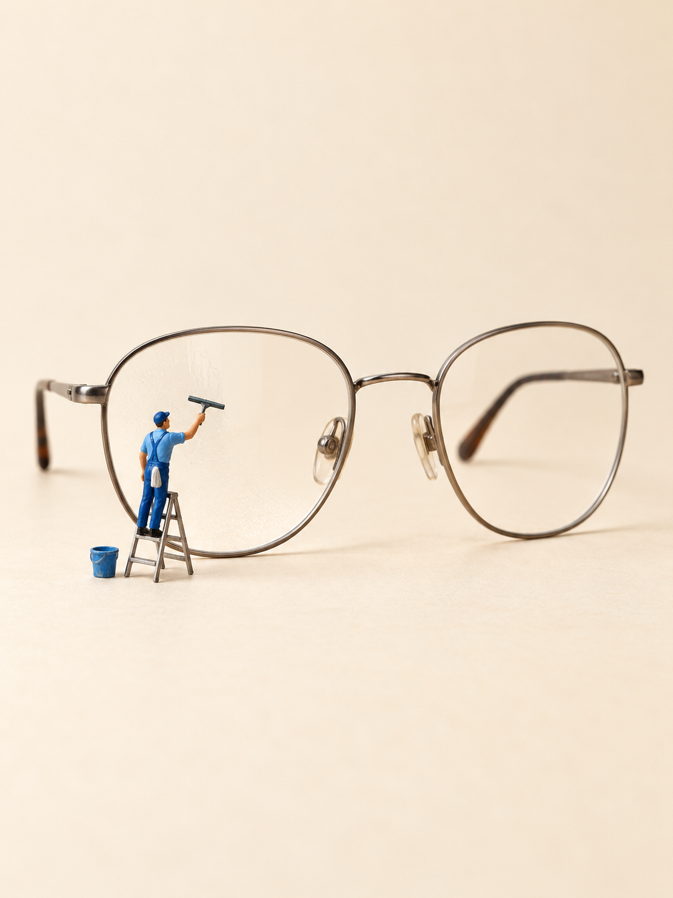<br>`glasses-window-cleaner-20261012.png` | 眼镜 · 擦窗：工人站在梯子上，像擦橱窗一样擦镜片。 | 只擦一侧镜片；眼镜为文字生成的普通款。 | G2.png · `57336e10f74a3c13a2b99cb34235a7ad5222d5cf1504ab6d7d30a14a6556ef6f` |
| <br>`mug-coffee-ring-track-20261012.png` | 马克杯 · 咖啡渍跑道：杯子留下的咖啡渍圈成为运动会跑道，孩子赛跑、奶奶加油。 | 部分孩子没有严格跑在圈线上。 | M1.png · `ccffd8220ba357eec184b66d2dba0a481a3022d6a554bd7c9970b2f378f76252` |
| <br>`mug-planter-20261012.png` | 马克杯 · 花盆：杯里装土，两位园丁种下一棵模型树。 | 杯中装满土，属于借用商品当花盆，商品展示用途需看场合。 | M2.png · `84c1b85b9f046239ef181c203ab203b62756191e9c2a3953c97f9f5b6440eefc` |
| <br>`mug-handle-photo-frame-20261012.png` | 马克杯 · 杯柄相框：游客在杯柄框里摆姿势，同伴拍照。 | 人物相对物件偏大；摆姿势的人站在杯柄下沿；杯身左侧被画面裁掉。 | M3.png · `d24e7f55223e19306a3a498d98873b9e54d2b082774f326a456d1372954256fc` |
| <br>`stapler-crocodile-feeding-20261012.png` | 订书机 · 喂鳄鱼：张开的订书机读作鳄鱼，饲养员递鱼喂食。 | 人物相对物件偏大；鳄鱼身份靠喂食动作撑起，不看动作时可能只读成订书机；鱼与水桶为添加道具。 | stapler-feeding.png · `70d4d3ac02cd01ca4476e9dbfd137f7f2af0af6582606416b856b071649ea2ef` |
| 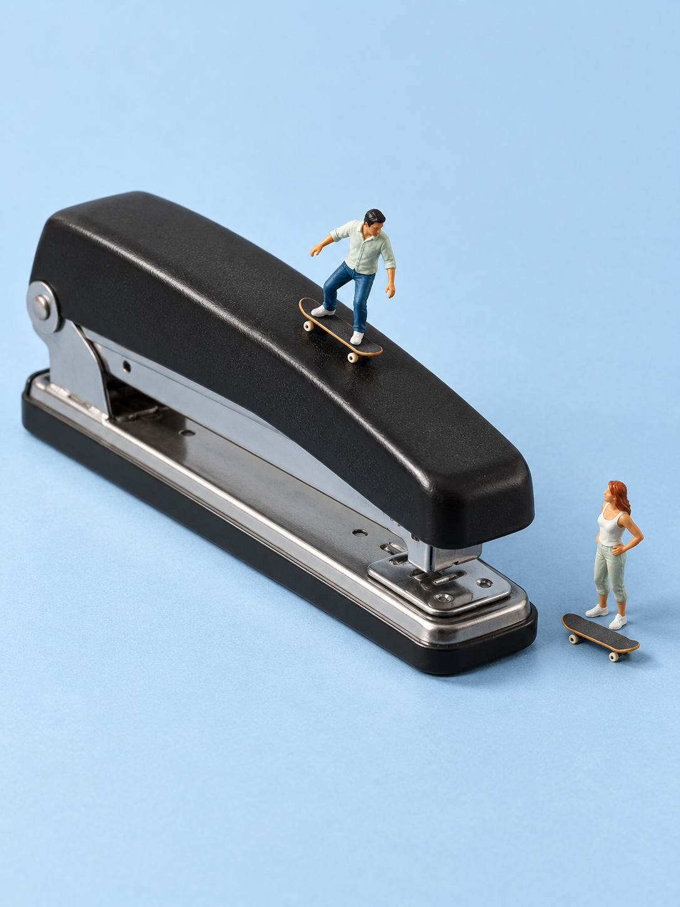<br>`stapler-skate-slope-20261012.png` | 订书机 · 滑板坡：上臂的坡度成为滑板道，一人滑行、一人等待。 | 人偶偏精致，塑料模型感不足。 | stapler-skate-slope.png · `851da3050c2155bad1d40724485f1d85750842d1b37a7291250f72d77ec10c8d` |
| 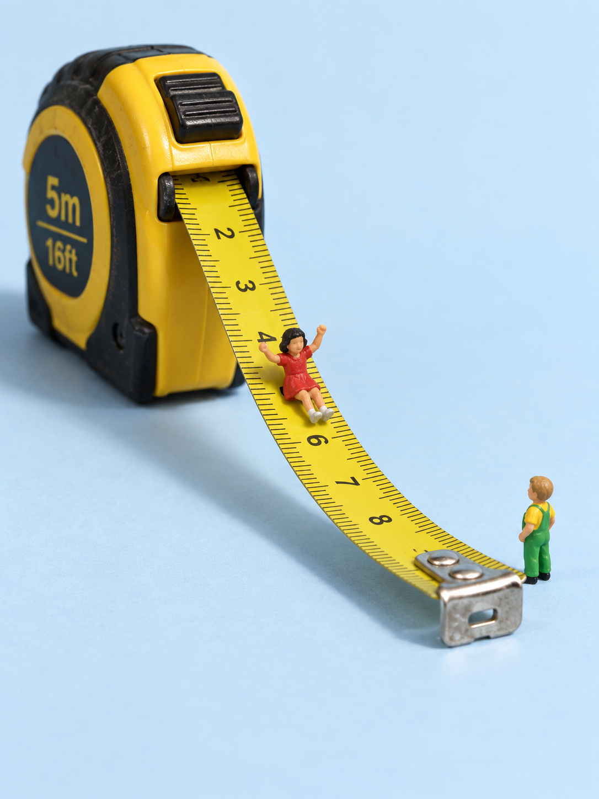<br>`tape-measure-slide-20261012.png` | 卷尺 · 滑梯：拉出的尺带弯成滑梯，孩子从上面滑下。 | 尺面刻度为生成内容，未与真实刻度核对。 | 01-tape-slide.png · `14a70254e981c4b0307caba5cc63070f5742b6e439fcbc6ba120268153aafc41` |
| 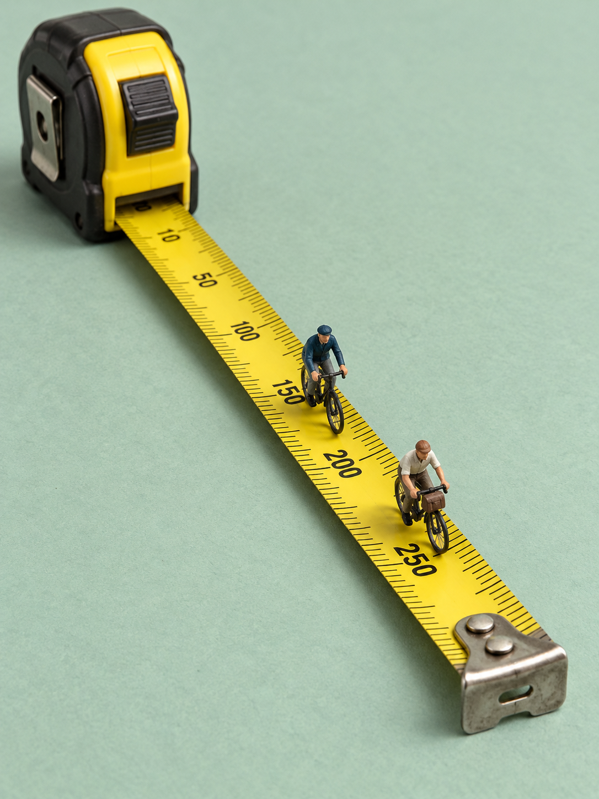<br>`tape-measure-cycleway-20261012.png` | 卷尺 · 自行车道：拉直的尺带成为自行车道，两人骑行。 | 尺面刻度间隔不规则，为生成内容。 | 02-tape-cycleway.png · `5d460455a675c0e8046f8ded498fd6bf29fb53954cf28633036201fb40a8cadd` |

用户认可可用不等于商品保真、人物比例或刻度文字通过；单一评审、样本少，不代表稳定产出率。用户批准本项目展示，不据此授予第三方素材或图片额外复用权，见[素材说明](../THIRD_PARTY_NOTICES.md#2026-10-12新测试案例)。
